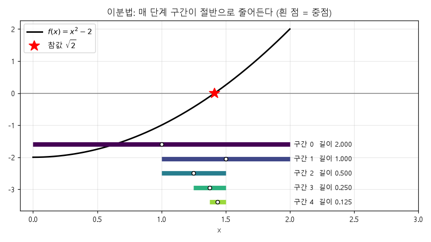
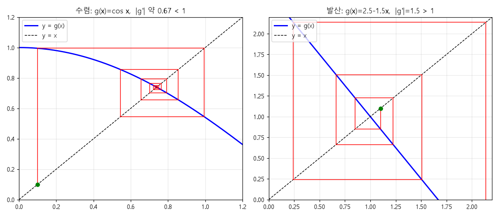
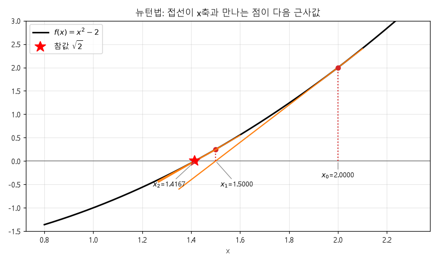
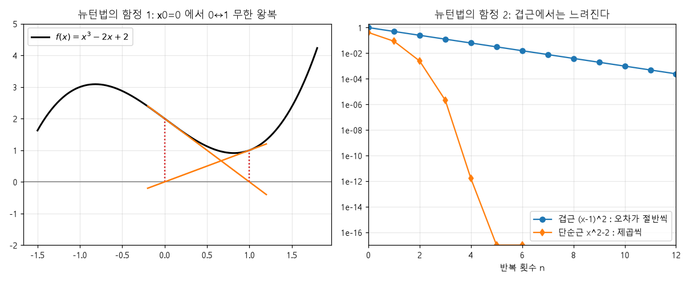
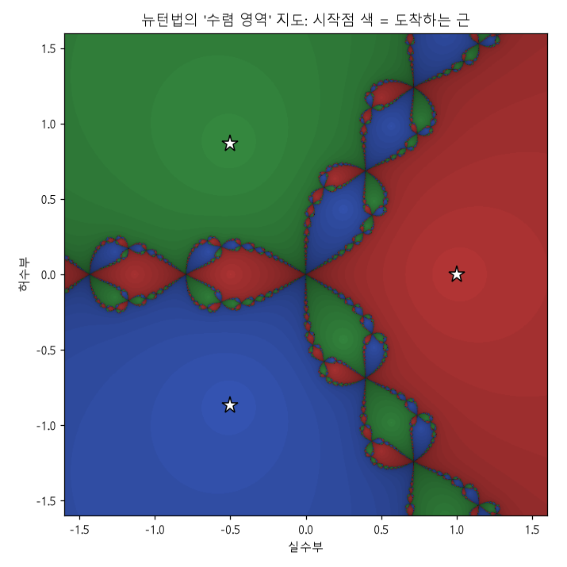
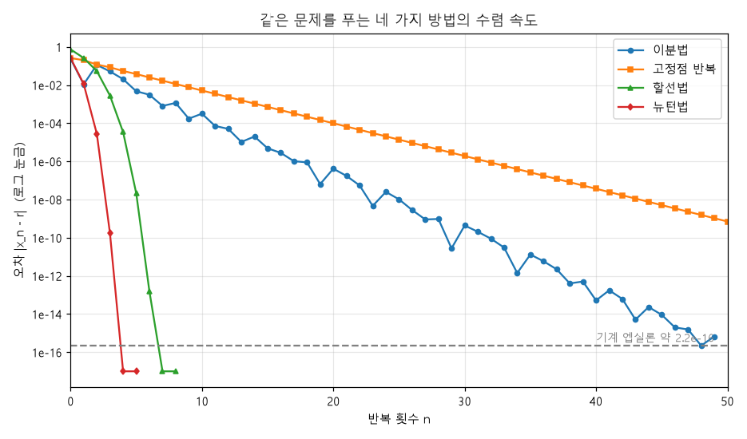

# 2단원: 방정식의 근 찾기

> 심심할 때 편하게 읽는 용도로 아주 자세하게 썼어요. 처음부터 끝까지 한 번에 읽어도 되고,
> 관심 있는 절만 골라 읽어도 돼요. 그림은 `figures/` 폴더에 있고, 전부
> `python 02_root_finding/experiments.py` 로 직접 다시 그릴 수 있어요.
>
> 읽는 시간: 약 40~50분 (코드를 돌려 보면 +1시간)

---

## 0. 이 단원에서 얻어 갈 것

1. 방정식 `f(x) = 0` 을 **컴퓨터가 반복해서 풀어 나가는 4가지 방법**을 직접 구현해 본다.
   - 이분법, 고정점 반복, 뉴턴법, 할선법
2. 각 방법이 **얼마나 빨리**(수렴 속도), **얼마나 안전하게**(수렴 보장) 근에 다가가는지 안다.
3. "수렴 차수"라는, 수치해석 전체에서 계속 쓰이는 핵심 개념을 몸으로 느낀다.
4. 뉴턴법이 **언제 망가지는지**도 안다. (이게 오히려 더 중요해요!)

1단원에서 배운 오차 감각이 그대로 쓰여요. "오차가 1e-16에서 멈춘다" 같은 부분은 거기서 온 거예요.

---

## 1. 왜 근 찾기가 필요할까?

### 공식이 없는 방정식이 훨씬 많다

이차방정식에는 근의 공식이 있고, 삼차·사차방정식에도 (복잡하지만) 있어요.
그런데 **5차 이상의 일반 다항식에는 근의 공식이 존재하지 않는다**는 게 증명되어 있어요 (아벨-루피니 정리).
다항식이 아닌 방정식은 더 말할 것도 없고요. 예를 들어:

```
cos(x) = x          ← 이 해를 사칙연산과 루트만으로 쓰는 방법은 없다
e^x = 3x²
x·ln(x) = 5
```

그래도 공학과 과학에서는 이런 방정식의 해가 필요해요. 그래서 **정확한 공식 대신, 근에 점점 가까워지는 수열을 만드는** 방법을 써요.

### 모든 방정식은 `f(x) = 0` 꼴로 쓸 수 있다

`cos(x) = x` 는 `f(x) = cos(x) - x = 0` 으로 바꿔 쓰면 돼요. 우변을 좌변으로 넘기기만 하면 되니까요.
이때 `f(r) = 0` 을 만족하는 `r` 을 **근(root)** 또는 **영점(zero)** 이라고 불러요.

### 이 단원의 큰 그림

모든 방법은 사실 같은 모양이에요.

```
1. 근 근처의 값 x₀ 를 하나 (또는 구간을) 고른다.
2. 더 좋은 값 x₁ 을 만든다.
3. x₂, x₃, ... 를 계속 만든다.
4. 충분히 가까워졌다 싶으면 멈춘다.
```

방법마다 **"더 좋은 값을 어떻게 만드느냐"** 가 달라요. 그 차이가 속도와 안전성을 결정해요.

---

## 2. 시작 전에: 오차와 멈추는 시점

### 2-1. 오차의 두 가지 정의

근의 참값을 `r`, n번째 근사값을 `x_n` 이라고 하면 **오차** `e_n = abs(x_n - r)` 이에요.

그런데 현실에서는 `r` 을 모르기 때문에(모르니까 푸는 거죠!) 오차를 직접 못 재요. 그래서 다른 기준으로 멈춰야 해요.

### 2-2. 멈추는 조건 세 가지

| 조건 | 의미 | 장점 / 단점 |
|---|---|---|
| `abs(x_{n+1} - x_n) < tol` | 값이 더 이상 안 변한다 | 가장 흔함. 느리게 수렴하는 방법에서는 "느려서 안 변하는 것"일 수도 있음 |
| `abs(f(x_n)) < tol` | 함수값이 거의 0이다 | 직관적. 하지만 f 가 완만하면 x 는 아직 멀 수 있음 |
| `n >= max_iter` | 너무 오래 돌았다 | **반드시 넣어야 하는 안전장치.** 수렴 안 하는 경우 무한 루프 방지 |

> 💡 **중요한 습관:** 반복 알고리즘에는 항상 `max_iter` 를 넣으세요. 발산하거나 왕복하는 경우에 컴퓨터가 영원히 돌지 않게 해 줘요.

`tol` (tolerance, 허용 오차)은 "이 정도면 됐다"의 기준이에요. 1단원에서 봤듯 float64의 한계(약 `1e-16`) 때문에 `tol` 을 이보다 작게 잡는 건 의미가 없어요.

---

## 3. 방법 1: 이분법 (Bisection)

### 3-1. 아이디어: 중간값 정리

> **중간값 정리:** 연속함수 `f` 가 구간 `[a, b]` 에서 `f(a)` 와 `f(b)` 의 부호가 서로 다르면,
> 그 구간 안에 `f(x) = 0` 인 점이 **반드시** 하나 이상 있다.

그림으로 생각하면 쉬워요. 연속인 곡선이 x축 아래에서 위로 올라가려면 어딘가에서 x축을 지나야 하니까요.

이 사실을 이용해서 **"근을 가두는 구간을 반씩 줄여 나가는"** 방법이 이분법이에요. 스무고개나 "up & down" 숫자 맞히기 게임과 똑같아요.

### 3-2. 알고리즘

```
입력: 구간 [a, b] (단, f(a) 와 f(b) 의 부호가 다름), 허용오차 tol

반복:
  1. 중점 c = (a + b) / 2 를 구한다.
  2. f(c) 의 부호를 본다.
       f(a) 와 f(c) 의 부호가 다르면 → 근은 [a, c] 에 있다 → b 를 c 로 교체
       같으면                         → 근은 [c, b] 에 있다 → a 를 c 로 교체
  3. 구간 길이가 충분히 작아지면 멈춘다.
```

### 3-3. 눈으로 보기



곡선은 `f(x) = x² - 2` 이고 근은 `√2 ≈ 1.41421` 이에요. 아래의 굵은 막대들이 단계마다의 구간이에요.
처음 구간 `[0, 2]` 에서 시작해 중점(흰 점)을 보고, 근이 있는 쪽 절반만 남기고 있어요. 길이가 2 → 1 → 0.5 → 0.25 → 0.125 로 **정확히 절반씩** 줄어드는 게 보이죠?

### 3-4. 실제 숫자 (실험 1의 출력)

`f(x) = x² - 2`, 구간 `[0, 2]`, 참값 `√2 = 1.41421356...`

```
  n               중점 c_n    abs(c_n - √2)      구간 절반 길이
  1    1.000000000000000        4.142e-01        1.000e+00
  2    1.500000000000000        8.579e-02        5.000e-01
  3    1.250000000000000        1.642e-01        2.500e-01
  4    1.375000000000000        3.921e-02        1.250e-01
  5    1.437500000000000        2.329e-02        6.250e-02
  6    1.406250000000000        7.964e-03        3.125e-02
  7    1.421875000000000        7.661e-03        1.562e-02
  8    1.414062500000000        1.511e-04        7.812e-03
```

여기서 꼭 눈여겨볼 점 두 가지:

1. **"구간 절반 길이"는 매번 정확히 절반**이 돼요. 이게 이분법의 가장 큰 장점이에요.
2. 그런데 **중점의 실제 오차(세 번째 열)는 항상 줄지는 않아요.** 2번째 줄(0.0858)에서 3번째 줄(0.1642)로 오히려 늘었죠. 운 좋게 근 가까이에 중점이 떨어질 때도 있고(8번째 줄: 1.5e-4), 아닐 때도 있어요.
   하지만 **오차가 "구간 절반 길이" 이하라는 건 항상 보장돼요.** 세 번째 열은 늘 네 번째 열보다 작아요.

### 3-4b. 몇 번 반복해야 할까? (오차 보장 공식)

중점 `c_n` 은 길이 `(b-a)/2^(n-1)` 인 구간의 한가운데이므로, 근과의 거리는 구간 절반 이하예요.

```
abs(c_n - r)  ≤  (b - a) / 2^n
```

원하는 허용오차 `tol` 이하로 만들려면 `(b-a)/2^n ≤ tol` 이어야 하니까, 양변에 로그를 취하면:

```
n  ≥  log2( (b - a) / tol )
```

예) `[0, 2]` 에서 `tol = 1e-10` → `n ≥ log2(2 / 1e-10) = log2(2×10^10) ≈ 34.2` → **35번**.
실제로 실험 1에서 코드를 돌리면 정확히 35번이 나와요. 🎯

더 감각적으로는: **이분법은 한 번 반복할 때마다 이진수 1비트(십진수로 약 0.3자리)씩 정확해진다**고 기억하면 돼요.
`1e-16` 까지 가려면 약 53번이면 충분하다는 뜻이기도 해요. (float64의 가수부가 52비트인 것과 맞아떨어지죠.)

### 3-5. 장단점

| 장점 | 단점 |
|---|---|
| ✅ 부호가 다른 구간만 찾으면 **무조건 수렴** (연속함수라면) | ❌ 느리다 (1비트씩) |
| ✅ 필요한 반복 횟수를 **미리 계산** 가능 | ❌ 부호가 다른 구간을 처음에 찾아야 함 |
| ✅ 도함수 필요 없음, 구현이 간단 | ❌ 근이 구간에서 부호가 안 바뀌는 경우(예: `x²` 의 근 0)에는 못 씀 |
| ✅ 함수가 이상해도(미분 불가능해도) 동작 | ❌ 방정식이 여러 변수면 확장이 어려움 |

그래서 이분법은 "**느리지만 절대 배신하지 않는 든든한 기본기**"로 여겨져요. 실전에서도 다른 빠른 방법과 섞어서(아래 8-3절) 많이 쓰여요.

---

## 4. 수렴 속도를 말하는 언어: 수렴 차수

방법을 더 배우기 전에, **"이 방법이 얼마나 빠른가"를 수치로 말하는 법**을 익혀 둬요.
이게 수치해석에서 가장 자주 나오는 개념 중 하나예요.

### 4-1. 정의

오차 `e_n` 이 0으로 갈 때, 어떤 상수 `p ≥ 1` 과 `C > 0` 에 대해

```
e_{n+1}  ≈  C · (e_n)^p
```

이면 이 방법은 **p차 수렴**한다고 해요. `p` 를 **수렴 차수**라고 불러요.

### 4-2. 감각적으로 이해하기

오차가 `0.01` 일 때 다음 오차가 얼마가 되는지 비교해 봐요 (`C = 1` 이라 가정).

| 차수 | 식 | 오차 0.01 → 다음 | 다시 → 다음 | 설명 |
|---|---|---|---|---|
| 1차 (선형) | `e_{n+1} = 0.5 e_n` 같은 형태 | 0.005 | 0.0025 | 매번 **일정 비율**로 줄어듦 |
| 1.6차 (초선형) | `e^1.6` | 6e-4 | 8e-6 | 줄어드는 비율 자체가 커짐 |
| 2차 (이차) | `e²` | 1e-4 | 1e-8 | 오차가 **제곱**됨 |
| 3차 | `e³` | 1e-6 | 1e-18 | 오차가 **세제곱**됨 |

핵심 직관은 이거예요:

> **정확한 자릿수 기준으로**
> - 1차 수렴: 매번 **일정한 개수**만큼 늘어난다 (예: 한 번에 0.3자리)
> - 2차 수렴: 매번 **두 배**로 늘어난다 (1자리 → 2 → 4 → 8 → 16)

그래서 2차 수렴은 정말 무섭게 빨라요. 처음에 한두 번 헤맨 뒤로는 3~4번 만에 float64의 한계(16자리)에 도달해요.

### 4-3. 로그 그래프에서의 모습

오차를 **세로축 로그 눈금**으로, 반복 횟수를 가로축으로 그리면:

- **선형 수렴 = 직선.** (기울기가 가파를수록 빠름)
- **초선형 / 2차 수렴 = 아래로 점점 더 휘어지는 곡선.**

뒤에 나올 비교 그래프(8절)에서 이걸 직접 볼 거예요.

### 4-4. 차수를 직접 추정하는 법

연속한 세 오차 `e_{n-1}, e_n, e_{n+1}` 이 있으면

```
p  ≈  log( e_{n+1} / e_n )  /  log( e_n / e_{n-1} )
```

로 차수를 추정할 수 있어요. (`rootfinding.py` 의 `estimate_order` 함수가 이걸 해 줘요.)
유도는 간단해요. `e_{n+1} = C e_n^p` 와 `e_n = C e_{n-1}^p` 를 각각 로그 취해서 나누면 `C` 가 사라지고 `p` 만 남아요. 직접 해 보면 5분이에요. 😊

---

## 5. 방법 2: 고정점 반복 (Fixed-Point Iteration)

### 5-1. 아이디어: 계산기 장난

계산기를 라디안 모드로 놓고 아무 숫자나 입력한 뒤 `cos` 버튼을 계속 눌러 보세요.
숫자가 이리저리 흔들리다가 **0.739085...** 로 수렴해요. 어떤 숫자로 시작해도요!

이 값 `r` 은 `cos(r) = r` 을 만족해요. 그러니까 `cos` 를 취해도 변하지 않는 점이에요.
이런 점을 함수 `g` 의 **고정점(fixed point)** 이라고 해요: `g(r) = r`.

### 5-2. 방법

`f(x) = 0` 을 `x = g(x)` 꼴로 바꿔 쓸 수 있다면, 다음 수열을 만들어요.

```
x_{n+1} = g(x_n)
```

이 수열이 어떤 값으로 수렴한다면(그리고 `g` 가 연속이라면) 그 값은 정확히 `g` 의 고정점, 즉 방정식의 해예요.

### 5-3. 실험 결과 (실험 2의 출력)

`g(x) = cos(x)`, `x₀ = 1.0`, `tol = 1e-12`

```
수렴한 값 0.739085133214773, 반복 69번
연속 오차 비 e_{n+1}/e_n : ['0.762', '0.596', '0.716', '0.641', '0.693', '0.660', '0.683', '0.667', '0.678']
→ 비가 약 abs(g'(r)) = abs(sin r) = 0.674 로 일정하다. (선형 수렴)
```

- 69번이나 돌렸어요. 이분법보다 느려요. (8절에서 같은 조건으로 비교하면 이분법 50번, 고정점 88번이에요.)
- 연속한 오차의 **비**(`e_{n+1}/e_n`)가 약 0.67 근처에서 맴돌아요. 이건 정확히 **선형 수렴(1차)** 의 증거예요. 그리고 이 0.67 이라는 숫자는 우연이 아니라 `abs(g'(r))` 와 같은 값이에요. 왜 그런지 곧 설명할게요.

### 5-4. 거미줄 그림 (Cobweb Diagram)

고정점 반복이 어떻게 움직이는지 보여 주는 아주 유명한 그림이에요.



**읽는 법:** 파란 곡선은 `y = g(x)`, 점선은 `y = x` 예요. 둘이 만나는 점이 고정점이에요.
녹색 점에서 출발해서:

1. **세로로** 이동해서 곡선에 닿는다. (이때 높이가 `g(x_n)`, 즉 `x_{n+1}`)
2. **가로로** 이동해서 `y = x` 직선에 닿는다. (`x_{n+1}` 을 다음 입력으로 옮기는 효과)
3. 반복.

**왼쪽 그림** (`g = cos x`): 사각형 모양으로 점점 안쪽으로 소용돌이쳐 들어가요. → **수렴**
**오른쪽 그림** (`g(x) = 2.5 - 1.5x`): 오히려 바깥으로 소용돌이쳐 나가요. → **발산**

차이는 뭘까요? 고정점 근처에서 곡선의 **기울기**예요!

### 5-5. 수렴 조건: 기울기의 크기가 1보다 작아야 한다

고정점 `r` 에서 `g` 의 기울기를 `g'(r)` 이라고 해요.

> **`abs(g'(r)) < 1` 이면 `r` 근처에서 수렴한다. `abs(g'(r)) > 1` 이면 발산한다.**

이유는 평균값 정리로 간단히 설명돼요. `x_{n+1} = g(x_n)` 이고 `r = g(r)` 이므로

```
e_{n+1} = abs(x_{n+1} - r) = abs(g(x_n) - g(r)) = abs(g'(ξ)) · abs(x_n - r) = abs(g'(ξ)) · e_n
```

(`ξ` 는 `x_n` 과 `r` 사이의 어떤 점이에요.) `x_n` 이 `r` 에 가까워지면 `ξ` 도 `r` 에 가까워지니까, 결국

```
e_{n+1}  ≈  abs(g'(r)) · e_n
```

즉 **매번 오차에 `abs(g'(r))` 를 곱하는** 거예요. 1보다 작으면 줄고, 크면 늘어나죠. 이게 바로 **선형 수렴이고, `C = abs(g'(r))`** 예요.
코사인의 경우 `g'(x) = -sin(x)`, `abs(g'(0.739)) = 0.674` 이니까 5-3절에서 관찰한 비 0.67과 딱 맞아요. 👏

> 💡 `g'(r)` 이 **음수**이면 (`cos` 처럼) 해가 좌우로 번갈아 오가며(소용돌이) 수렴하고, **양수**이면 한쪽에서 계단처럼 다가가요.
> 거미줄 그림에서 왼쪽 그림이 소용돌이인 이유예요.

### 5-5b. 같은 방정식, 다른 `g` 선택: 운명이 갈린다

`x² - 2 = 0` (근 `√2 ≈ 1.4142`) 을 `x = g(x)` 꼴로 쓰는 방법은 여러 가지예요.

| `g(x)` | 만든 방법 | `g'(x)` | `g'(√2)` | 결과 |
|---|---|---|---|---|
| `x² + x - 2` | 양변에 `x` 더하기 | `2x + 1` | **3.83** | 발산 (거미줄이 폭발) |
| `2 / x` | `x² = 2` 의 양변을 `x` 로 나누기 | `-2/x²` | **-1** | 안 수렴, 영원히 왔다 갔다 |
| `(x + 2/x) / 2` | 위 둘의 평균! | `(1 - 2/x²)/2` | **0** | **엄청 빠르게 수렴** |

세 번째를 보세요. `g'(r) = 0` 이면 오차에 곱해지는 값이 0이니까 선형보다 훨씬 빨라요. 이 `g` 를 쓰면:

```
x₀ = 1.5
x₁ = 1.4166666666666665
x₂ = 1.4142156862745097
x₃ = 1.4142135623746899
x₄ = 1.414213562373095     ← √2 의 float64 값과 같음
```

4번 만에 끝났어요. 이 식이 어디서 왔는지는 다음 절에서 밝혀져요. 🕵️

> 📝 **연습문제 3번**에서 이 세 가지를 직접 돌려 볼 거예요.

---

## 6. 방법 3: 뉴턴법 (Newton's Method)

수치해석에서 가장 유명하고 가장 많이 쓰이는 방법이에요.

### 6-1. 아이디어: 곡선을 직선으로 근사한다

곡선 `f(x) = 0` 의 근은 찾기 어렵지만, **직선의 근은 쉬워요.**
현재 추측값 `x_n` 에서 곡선에 **접선**을 그으면, 접선은 곡선의 아주 좋은 직선 근사예요.
그 접선이 x축과 만나는 점을 다음 추측값으로 삼아요. 그림을 먼저 볼게요.



`f(x) = x² - 2`, `x₀ = 2` 에서 출발해요.

1. `x₀ = 2` 에서 곡선 위의 점 `(2, f(2))` 을 잡고 접선을 그어요. (주황색 직선)
2. 그 접선이 x축과 만나는 점이 `x₁ = 1.5` 예요.
3. `x₁` 에서 다시 접선을 그어요 → `x₂ = 1.4167`.
4. 별(`√2`)에 거의 도착했어요. 3번 만에요!

### 6-2. 식 유도

점 `(x_n, f(x_n))` 에서 기울기 `f'(x_n)` 인 접선의 식은

```
y = f(x_n) + f'(x_n) · (x - x_n)
```

이 직선이 x축과 만나는 점은 `y = 0` 을 풀면 돼요.

```
0 = f(x_n) + f'(x_n) · (x - x_n)
x = x_n - f(x_n) / f'(x_n)
```

이 `x` 를 새 추측값 `x_{n+1}` 로 삼는 게 뉴턴법이에요.

```
┌──────────────────────────────────────┐
│   x_{n+1} = x_n  -  f(x_n) / f'(x_n)  │
└──────────────────────────────────────┘
```

> 💡 **같은 식을 테일러 급수로도 볼 수 있어요.** `f(x) ≈ f(x_n) + f'(x_n)(x - x_n)` 이라는 1차 테일러 근사를 0으로 놓고 푼 거예요.
> 이 관점은 나중에 다변수 뉴턴법이나 최적화에서 다시 만나요.

### 6-3. 식을 읽는 법

`f(x_n) / f'(x_n)` 은 "지금 높이를 기울기로 나눈 값" = **x축까지 가려면 가로로 얼마나 가야 하는가**예요.
(높이가 높을수록 멀리 가야 하고, 기울기가 가파를수록 조금만 가도 돼요.) 그만큼 빼 주는 거죠.

### 6-4. 5-5b절의 수수께끼 풀이: 바빌로니아 방법

`f(x) = x² - a` (근은 `√a`) 에 뉴턴법을 적용하면 `f'(x) = 2x` 이므로

```
x_{n+1} = x_n - (x_n² - a) / (2 x_n)
        = (2 x_n² - x_n² + a) / (2 x_n)
        = (x_n² + a) / (2 x_n)
        = ( x_n + a / x_n ) / 2
```

앞에서 그 "엄청 빨랐던" `g(x) = (x + 2/x) / 2` 가 바로 `a = 2` 인 뉴턴법이었어요!
이 식은 **"추측값 `x` 와 `a/x` 의 평균을 낸다"** 는 아주 오래된 제곱근 계산법이에요. 고대 바빌로니아 시대부터 쓰였다고 해서 **바빌로니아 방법**이라고 불러요. 컴퓨터가 제곱근을 계산할 때도 이런 뉴턴 반복 계열의 아이디어를 쓰는 경우가 많아요.

왜 효과가 있는지 직관: `x` 가 `√a` 보다 크면 `a/x` 는 `√a` 보다 작아요 (곱이 `a` 이므로). 그러니까 둘의 평균은 두 값 사이 어딘가, 즉 `√a` 에 더 가까워져요.

### 6-5. 실험 결과 (실험 3의 출력)

`f(x) = x² - 2`, `x₀ = 2`

```
 n                    x_n    abs(x_n - √2)
 0     2.0000000000000000        5.858e-01
 1     1.5000000000000000        8.579e-02
 2     1.4166666666666667        2.453e-03
 3     1.4142156862745099        2.124e-06
 4     1.4142135623746899        1.595e-12
 5     1.4142135623730951        0.000e+00
```

**오차를 보세요:** `5.9e-1 → 8.6e-2 → 2.5e-3 → 2.1e-6 → 1.6e-12 → (끝)`

| 단계 | 맞는 소수점 자릿수 |
|---|---|
| `x₁` | 약 1자리 |
| `x₂` | 약 2~3자리 |
| `x₃` | 약 5자리 |
| `x₄` | 약 11자리 |
| `x₅` | 16자리 (한계) |

**자릿수가 매번 대략 두 배로** 늘어나요. 이게 **2차 수렴**이에요.

### 6-6. 왜 2차 수렴일까?

뉴턴법은 `g(x) = x - f(x)/f'(x)` 라는 고정점 반복이에요. 이 `g` 를 미분하면

```
g'(x) = 1 - (f'(x)² - f(x) f''(x)) / f'(x)²  =  f(x) f''(x) / f'(x)²
```

근 `r` 에서 `f(r) = 0` 이므로 **`g'(r) = 0`** 이에요! (`f'(r) ≠ 0` 이라면)
5-5절에서 `e_{n+1} ≈ abs(g'(r)) · e_n` 이었으니, 선형 계수가 0이 되어 더 높은 차수의 항이 남아요. 테일러 전개를 한 단계 더 하면

```
e_{n+1}  ≈  ( abs(f''(r)) / (2 abs(f'(r))) ) · e_n²
```

즉 **제곱**이에요. 직접 확인해 볼까요? `f = x² - 2` 이면 `f'' = 2`, `f'(√2) = 2√2` 이므로 계수는

```
f'' / (2 f')  =  2 / (2 · 2√2)  =  1 / (2√2)  ≈  0.3536
```

실험 숫자로 `e_{n+1} / e_n²` 을 계산하면:

| n | `e_{n+1} / e_n²` |
|---|---|
| 1 → 2 | `2.453e-3 / (8.579e-2)² = 0.333` |
| 2 → 3 | `2.124e-6 / (2.453e-3)² = 0.353` |

0.3536 에 아주 가까워져요! 이론이 정확히 맞아요. 🎉

### 6-7. 수렴 차수를 직접 측정하기 (실험 5)

1단원에서 본 것처럼 float64는 `1e-16` 에서 오차가 멈춰서 차수를 측정할 점이 몇 개 안 남아요.
그래서 실험 5에서는 **파이썬의 `decimal` 모듈로 60자리 정밀도**를 써서 계산했어요.

```
뉴턴 오차 : 4.1e-01, 8.6e-02, 2.5e-03, 2.1e-06, 1.6e-12, 9.0e-25, 2.9e-49
뉴턴 차수 추정: 2.26, 1.98, 2.00, 2.00, 2.00      (이론: 2)
```

오차가 `1e-12 → 1e-25 → 1e-49` 로 정말 **자릿수가 두 배씩** 늘어나요. 그리고 추정한 차수가 정확히 2.00 으로 수렴해요.

### 6-8. 뉴턴법이 실패하는 경우

빠르지만 **안전하지는 않아요.** 알아 둬야 할 대표적인 함정들:



**함정 1: 왕복 (왼쪽 그림)**
`f(x) = x³ - 2x + 2`, `x₀ = 0`. 접선이 0에서 1로 보내고, 1에서의 접선이 다시 0으로 돌려보내요.
영원히 `0 → 1 → 0 → 1 ...` 을 반복해요. (실험 6의 출력: `[0.0, 1.0, 0.0, 1.0, ...]`)

**함정 2: 겹근에서 느려짐 (오른쪽 그림)**
`f(x) = (x-1)²` 처럼 근이 **겹쳐 있으면**(`f'(r) = 0`) 뉴턴법은 2차 수렴이 아니라 **선형 수렴(비율 1/2)** 으로 떨어져요.
실험에서 오차가 `1.0, 0.5, 0.25, 0.125, ...` 로 정확히 절반씩 줄어요.
파란색(겹근)과 주황색(단순근) 곡선의 기울기 차이가 극명해요.

**그 외에 알아 둘 것들:**

| 상황 | 일어나는 일 |
|---|---|
| `f'(x_n) = 0` | 접선이 수평 → x축과 안 만남 → 0으로 나누기 (코드에서 `ZeroDivisionError`) |
| `f'(x_n)` 이 매우 작음 | 다음 점이 엄청 멀리 튕겨 나감 |
| 시작점이 근에서 멀다 | 엉뚱한 근으로 가거나 발산할 수 있음 |
| `f(x) = cbrt(x)` (세제곱근) | `x_{n+1} = -2 x_n` 이 되어 **매번 두 배씩 멀어짐** (연습문제 5번) |
| 도함수를 모르거나 계산이 비쌈 | 뉴턴법을 쓸 수 없음 → 할선법 (7절) |

### 6-9. 보너스: 뉴턴 프랙탈 🌀

뉴턴법의 "시작점에 따라 결과가 크게 달라질 수 있다"는 약점은 그 자체로 아름다운 그림이 돼요.

복소수 평면에서 `z³ - 1 = 0` 의 세 근 (`1`, `e^{2πi/3}`, `e^{-2πi/3}`) 을 뉴턴법으로 찾는다고 해 봐요.
평면의 모든 점을 시작점으로 놓고, **어느 근으로 가는지에 따라 색을 칠하면:**



- 별(★)이 세 근이에요.
- 빨강, 초록, 파랑은 "그 점에서 출발하면 어느 근으로 가는가"예요.
- 근 가까이서는 안정적인 큰 영역이지만, **영역의 경계는 무한히 복잡한 프랙탈**이에요. 경계 근처에서는 아주 작게 시작점을 바꿔도 전혀 다른 근으로 갈 수 있어요.
- 어두운 곳은 수렴하는 데 반복이 많이 필요한 곳이에요.

> 📝 **연습문제 6번**에서 `z⁴ - 1`, `z⁵ - 1` 로 바꿔 그려 볼 수 있어요. 직접 바꿔 보면 진짜 재밌어요!

---

## 7. 방법 4: 할선법 (Secant Method)

### 7-1. 아이디어: 도함수 대신 두 점을 쓰자

뉴턴법은 훌륭하지만 **`f'(x)` 를 알아야** 해요. 도함수를 구하기 어렵거나, 함수가 데이터나 시뮬레이션이라 식이 없으면 쓸 수 없어요.

그럴 땐 도함수의 정의를 떠올려 봐요. `f'(x_n)` 은 두 점의 기울기의 극한이니까, **최근 두 점의 기울기**로 대신 쓰는 거예요.

```
f'(x_n)  ≈  ( f(x_n) - f(x_{n-1}) ) / ( x_n - x_{n-1} )
```

이걸 뉴턴 식에 넣으면 **할선법**이에요.

```
x_{n+1} = x_n  -  f(x_n) · (x_n - x_{n-1}) / ( f(x_n) - f(x_{n-1}) )
```

기하학적으로는, 곡선 위의 두 점을 잇는 **할선(割線)** 이 x축과 만나는 점을 다음 추측으로 삼는 거예요. (접선 대신 할선!)

### 7-2. 특징

- 시작점이 **두 개** 필요해요 (`x₀`, `x₁`). 부호가 달라야 할 필요는 없어요.
- 반복마다 `f` 를 **새로 한 번만** 계산하면 돼요. (이전 값을 재사용하니까.) 뉴턴법은 `f` 와 `f'` 를 둘 다 계산해야 해요.
  (`rootfinding.py` 의 구현은 읽기 쉽게 매번 두 값을 다 계산하지만, 값을 저장해 두면 한 번만 계산해도 돼요.)
- 수렴 차수는 **약 1.618** (황금비 `(1+√5)/2`) 이에요. 이차보다는 느리지만 선형보다 훨씬 빨라요.

### 7-3. 실험 결과 (실험 5의 출력)

`f = x² - 2`, `x₀ = 1`, `x₁ = 2`, 60자리 정밀도

```
할선 오차 : 4.1e-01, 5.9e-01, 8.1e-02, 1.4e-02, 4.2e-04, 2.1e-06, 3.2e-10, 2.4e-16, 2.6e-26, 2.2e-42
할선 차수 추정: -5.71, 0.88, 2.02, 1.50, 1.67, 1.60, 1.63, 1.62      (이론: 약 1.618)
```

초반에는 흔들리지만(처음에는 점들이 근과 멀어서 "점근적" 성질이 아직 안 나타나요), 뒤로 갈수록 **1.62 근처에 안정**돼요. 이론값 1.618 과 딱 맞아요.

> 💡 **"수렴 차수는 점근적 개념"** 이에요. 즉 오차가 충분히 작아진 뒤에야 의미가 있어요. 초반의 `-5.71`, `0.88` 같은 값은 무시하는 게 맞아요.

### 7-4. 뉴턴법 vs 할선법: 누가 더 효율적일까?

차수만 보면 뉴턴(2) > 할선(1.618)이지만, **비용**까지 고려하면 이야기가 달라져요.
`f'` 를 계산하는 데 `f` 와 비슷한 비용이 든다면, 뉴턴법은 반복당 비용이 2배예요.
이를 "효율 지수"로 비교하면 (차수의 `1/반복당 비용` 제곱):

| 방법 | 차수 | 반복당 함수 평가 | 효율 지수 |
|---|---|---|---|
| 뉴턴 | 2 | 2 (`f`, `f'`) | 2^(1/2) ≈ 1.414 |
| 할선 | 1.618 | 1 (`f`) | 1.618^(1/1) = **1.618** |

**할선법이 더 효율적일 수 있어요.** 그래서 `f'` 가 비싸거나 구하기 어려우면 할선법이 훨씬 나은 선택이에요. (물론 `f'` 가 공짜로 나오는 경우엔 뉴턴이 낫죠.)

---

## 8. 종합 비교

### 8-1. 같은 문제를 네 가지 방법으로 풀어 보자

문제: `f(x) = cos(x) - x = 0` (근은 약 `0.7390851332151607`), 목표 `tol = 1e-15`

| 방법 | 설정 | 반복 횟수 |
|---|---|---|
| 이분법 | 구간 `[0, 1]` | **50번** |
| 고정점 반복 | `g = cos`, `x₀ = 1` | **88번** |
| 할선법 | `x₀ = 0, x₁ = 1` | **9번** |
| 뉴턴법 | `x₀ = 1` | **6번** |

(실험 4의 출력이에요.)



**그래프 읽는 법**: 세로축은 오차(로그 눈금)이고 아래로 갈수록 정확해요. 회색 점선은 float64의 한계(약 `2.2e-16`)예요.

- 🟠 **고정점** (주황): 완만한 **직선**. 매번 일정 비율(약 0.67)로 줄어요 → 선형 수렴.
- 🔵 **이분법** (파랑): 역시 직선처럼 내려가지만 오르락내리락해요. 평균적으로 1비트(약 0.3자리)씩. (3-4절에서 본 "중점 오차는 단조롭지 않다"가 이 들쭉날쭉한 모양이에요.)
- 🟢 **할선법** (초록): 눈에 띄게 아래로 **휘어지는** 곡선. 초선형 수렴.
- 🔴 **뉴턴법** (빨강): 거의 **수직 낙하**. 2차 수렴.
- 오차가 점선(`1e-16`)에 닿으면 모두 멈춰요. (1단원: 반올림 오차의 벽!)

### 8-2. 한눈에 보는 비교표

| | 이분법 | 고정점 반복 | 뉴턴법 | 할선법 |
|---|---|---|---|---|
| **수렴 차수** | 1 (선형, 1비트씩) | 1 (선형, 비율 `abs(g')`) | **2** | 약 1.618 |
| **수렴 보장** | ✅ 항상 (부호가 다른 구간이 있다면) | ⚠️ `abs(g') < 1` 일 때만 | ⚠️ 시작점이 좋을 때만 | ⚠️ 시작점이 좋을 때만 |
| **필요한 것** | 부호가 다른 구간 | `g` 선택 | 도함수 `f'` | 시작점 2개 |
| **반복당 `f` 평가** | 1 | 1 | 2 (`f`, `f'`) | 1 |
| **장점** | 안전, 단순 | 단순, 개념적으로 중요 | 극강의 속도 | 도함수 불필요, 빠름 |
| **약점** | 느림 | `g` 고르기 어려움 | 함정이 많음 | 함정이 많음 |

### 8-3. 그래서 실전에서는?

**"안전한 방법 + 빠른 방법"을 섞어서** 써요. 즉:

1. 안전한 구간(이분법식)을 항상 유지하고,
2. 빠른 방법(할선법/뉴턴법식)이 구간 안에서 좋은 점을 제안하면 그걸 쓰고,
3. 제안이 별로면(구간 밖이거나 진전이 적으면) 이분법 한 번으로 안전하게 넘어가요.

이걸 구현한 게 **Brent 방법**이에요. 파이썬에서는 `scipy.optimize.brentq` 가 이거예요. 여러분이 이 단원에서 배운 이분법, 할선법이 그 안에 들어 있어요. 이제 라이브러리 안을 이해하고 쓸 수 있는 거죠!

---

## 9. 1단원과의 연결: 부동소수점의 벽

### 9-1. "수렴했는데 오차가 1e-16 에서 멈춘다"

비교 그래프의 점선과 뉴턴법 결과 마지막 줄 `x₆ = 1.4142135623730949` (참값과 `2.2e-16` 차이)를 보세요.
알고리즘이 아무리 좋아도, **float64로는 `1e-16` 보다 더 정확한 근을 표현할 수 없어요.**
수렴 속도가 아무리 빨라도 도착하는 곳은 "부동소수점이 표현 가능한 가장 가까운 값" 근처예요.

그래서 `tol = 1e-20` 같은 값을 주면 **영원히 만족 못 하고** `max_iter` 에 걸려요. (그래서 `max_iter` 가 필수예요!)

### 9-2. `f(x)` 가 작다고 `x` 가 정확한 건 아니다

`abs(f(x)) < tol` 만으로 멈추면 위험한 경우가 있어요. 근 근처에서 `f` 가 거의 평평하면(예: 겹근 근처), `f(x)` 가 `1e-16` 이어도 `x` 는 `1e-8` 만큼이나 틀려 있을 수 있어요. 예를 들어 `f(x) = (x-1)²` 에서 `x = 1 + 1e-8` 이면 `f = 1e-16` 이에요.
이건 1단원에서 배운 **조건수**의 이야기예요: 겹근은 **조건이 나쁜 문제**라서, 입력의 작은 오차(반올림!)가 근에 훨씬 크게 영향을 줘요.
(참고: 유명한 "윌킨슨 다항식"은 `(x-1)(x-2)...(x-20)` 의 계수를 아주 조금만 바꿔도 근이 복소수로 튀어 나가는 극적인 예예요.)

### 9-3. 이분법의 사소한 함정: 중점 계산

`c = (a + b) / 2` 는 `a`, `b` 가 아주 크면 `a + b` 가 오버플로우될 수 있어요. 그래서 실전 코드에서는 `c = a + (b - a) / 2` 를 쓰기도 해요. (수학적으로 같지만 수치적으로 안전한 형태로 바꾼다는 1단원의 철학이 그대로 나와요.)

---

## 10. 코드 읽는 법

### 10-1. 파일 구성

```
02_root_finding/
  rootfinding.py   ← 알고리즘들 (bisection, fixed_point, newton, secant, estimate_order)
  experiments.py   ← 위의 실험들 + 그래프 그리기
  exercises.py     ← 연습문제 (TODO 채우기)
  lesson.md        ← 지금 읽고 있는 이 파일
  figures/         ← 실험으로 만들어진 그래프들
```

### 10-2. 핵심 함수의 모양

모든 함수가 **`(근사값, history)`** 를 돌려줘요. `history` 는 반복 과정에서 거친 값들의 목록이에요.

```python
from rootfinding import newton

root, history = newton(lambda x: x**2 - 2, lambda x: 2*x, x0=2.0)
print(root)             # 1.4142135623730951
print(len(history))     # 몇 번 만에 도착했는지
print(history)          # 지나온 길 전체
```

이 `history` 덕분에 "오차가 어떻게 줄어드는지"를 그래프로 그리거나 차수를 추정할 수 있어요.
(수치해석에서는 **"답만 구하지 말고 과정을 기록하라"** 가 아주 중요한 습관이에요.)

### 10-3. 뉴턴법 구현을 한 줄씩 읽어 보자

```python
def newton(f, df, x0, tol=1e-12, max_iter=100):
    x = x0
    history = [x]
    for _ in range(max_iter):          # 안전장치: 최대 반복
        d = df(x)
        if d == 0:                     # 접선이 수평이면 중단
            raise ZeroDivisionError(...)
        x_new = x - f(x) / d           # ← 뉴턴 식 그대로
        history.append(x_new)
        if abs(x_new - x) < tol:       # 값이 더 안 변하면 수렴
            return x_new, history
        x = x_new
    return x, history                  # max_iter 도달 (수렴 못 했을 수도 있음)
```

수식 `x_{n+1} = x_n - f(x_n)/f'(x_n)` 이 코드 한 줄(`x_new = x - f(x) / d`)과 일대일로 대응돼요. 수치해석의 구현이 이렇게 짧고 아름다운 게 매력이에요.

---

## 11. 자주 하는 질문 (FAQ)

**Q1. 뉴턴법이 제일 빠른데 왜 다른 방법을 배워요?**
A. 뉴턴법은 시작점이 나쁘면 발산하거나 엉뚱한 근으로 가고, 도함수가 필요해요. 그래서 안전한 이분법으로 대략 위치를 잡고, 뉴턴이나 할선법으로 정밀하게 다듬는 식으로 같이 써요. (Brent 방법이 이 아이디어예요.)

**Q2. 이분법에서 `f(a)·f(b) < 0` 인데 근이 여러 개면?**
A. 구간 안에 근이 **홀수 개** 있어요 (겹근은 중복해서 셈). 이분법은 그중 하나만 찾아요. 어느 근인지는 보장하지 못해요.

**Q3. 근이 몇 개인지 어떻게 알아요?**
A. 일반적인 방법은 없어요. 보통은 `f` 를 그래프로 그려서 부호 변화를 눈으로 찾아요. 이분법은 항상 "부호가 다른 구간"에서 시작하니까, 구간을 잘게 나눠서 부호가 바뀌는 곳을 먼저 스캔하는 전략도 많이 써요.

**Q4. 고정점 반복은 느려서 쓸모없는 것 아닌가요?**
A. 그 자체로는 느리지만 **개념이 중요해요.** 뉴턴법도 고정점 반복의 특수한 경우예요(`g'(r) = 0` 이 되도록 `g` 를 잘 고른 것). 그리고 3단원의 Jacobi / Gauss-Seidel 도 이 아이디어의 연립방정식 버전이에요! 그때 이 거미줄 그림 생각이 날 거예요.

**Q5. 수렴 차수가 같으면 속도가 같은가요?**
A. 아니에요. 같은 선형 수렴이라도 비율 `C` 에 따라 달라요 (고정점의 `C ≈ 0.67` 은 이분법의 `0.5` 보다 약간 느려요 — 실험 4에서 88번 vs 50번이 그래서 나온 거예요).

**Q6. `tol` 은 얼마로 잡아야 하나요?**
A. 필요한 정확도에 맞추세요. 보통 `1e-8 ~ 1e-12` 면 충분해요. `1e-16` 보다 작게는 절대 의미가 없어요 (9-1절).

---

## 12. 요약 (치트시트)

```
이분법   : 구간을 반씩.            안전, 느림 (1비트/회).     오차 ≤ (b-a)/2^n
고정점   : x_{n+1} = g(x_n).      abs(g'(r)) < 1 이면 수렴.  선형, 비율 = abs(g'(r))
뉴턴     : x - f/f'.              2차 수렴, 빠름.            시작점 민감, f' 필요
할선     : f' 를 두 점 기울기로.   차수 1.618.                f' 불필요, 반복당 f 한 번
수렴 차수 : e_{n+1} ≈ C·e_n^p.    p=1 선형 / p=2 자릿수가 두 배씩
추정     : p ≈ log(e_{n+1}/e_n) / log(e_n/e_{n-1})
```

### 이 단원에서 꼭 가져갈 세 가지 감각

1. **"오차가 어떻게 줄어드는가"를 로그 그래프로 보는 눈.** (직선 = 선형, 휘는 곡선 = 빠른 수렴)
2. **빠른 방법은 대개 덜 안전하다.** (속도와 안전성의 교환)
3. **뭔가 구현했으면 `history` 를 남기고 그려 보라.** (숫자 하나보다 곡선 하나가 훨씬 많은 걸 말해 줘요.)

---

## 13. 이번 주 할 일

1. 이 문서를 읽고, 이해 안 되는 부분은 표시해 두기 (저한테 물어봐 주세요!)
2. `python 02_root_finding/experiments.py` 를 실행하고 `figures/` 의 그림들을 직접 열어 보기
3. `exercises.py` 의 **문제 1, 2, 3** 풀기 (쉬워요. 4~6번은 도전 문제예요)
4. 실험 4 에서 `tol` 이나 시작점을 바꿔 보기. 뉴턴법의 `x0` 를 `-3` 이나 `5` 로 바꾸면 어떻게 될까요?

다음 단원(3단원)은 **연립일차방정식**이에요. 변수가 하나였던 `f(x) = 0` 이, 이제 변수가 수백 개인 `A x = b` 가 돼요.
이 단원의 "고정점 반복"과 "수렴 속도"가 거기서 Jacobi, Gauss-Seidel 이라는 이름으로 다시 등장해요. 😊
