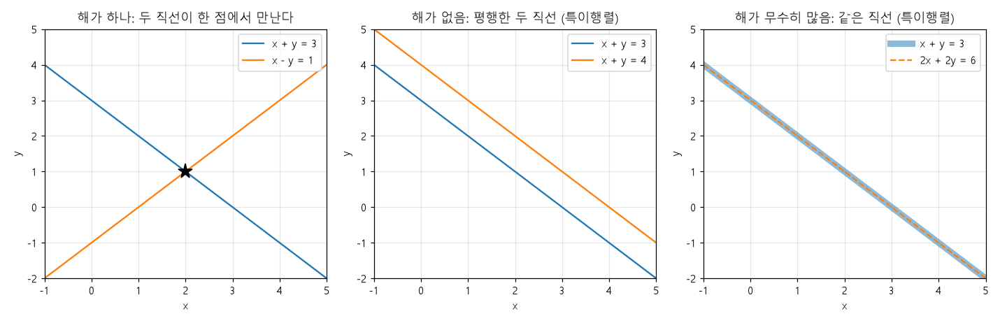
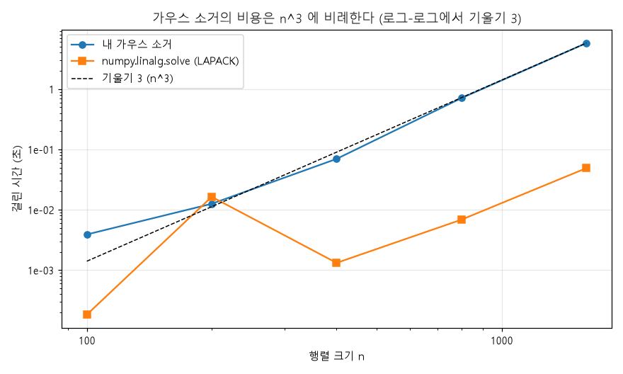
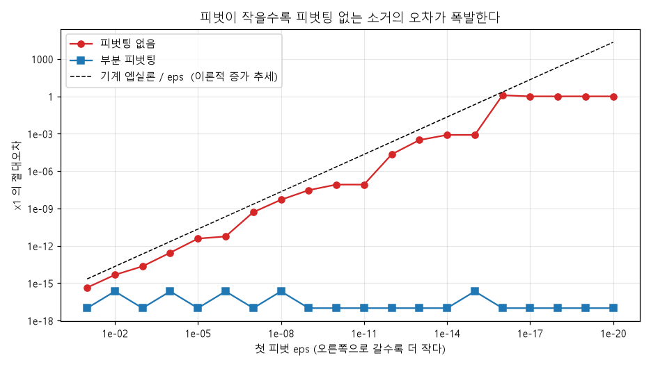
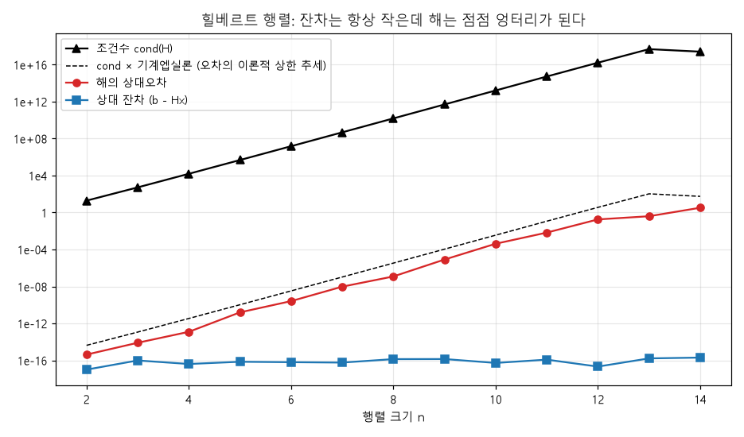
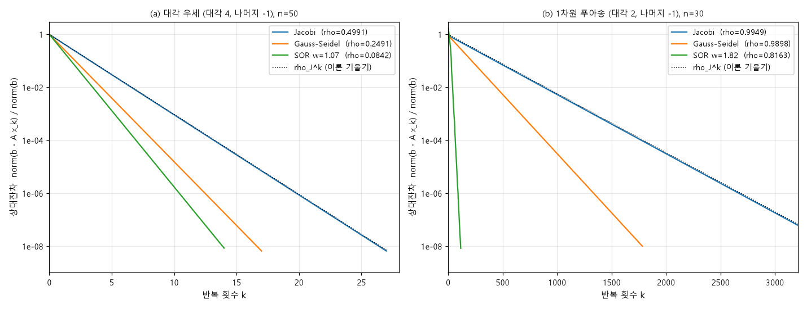
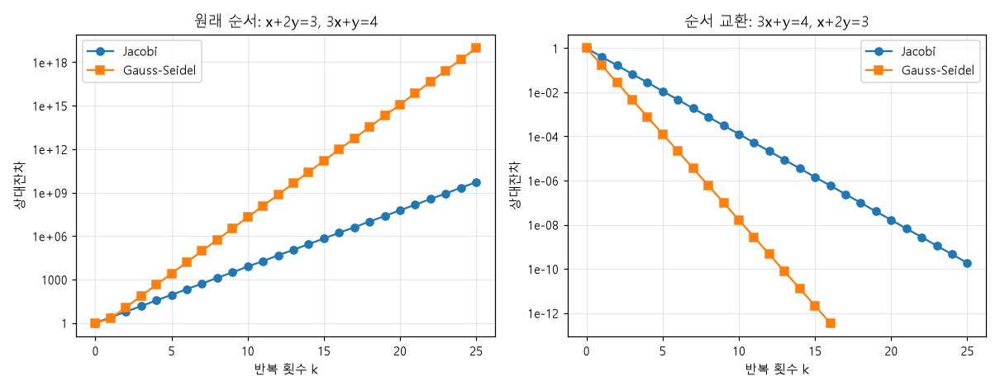

# 3단원: 연립일차방정식 `A x = b`

> 심심할 때 편하게 읽는 용도로 아주 자세하게 썼어요. 모든 그림은 `figures/` 폴더에 있고,
> `python 03_linear_systems/experiments.py` 로 직접 다시 그릴 수 있어요. (약 30초 걸려요)
>
> 읽는 시간: 약 60분 (코드까지 돌려 보면 +1~2시간). 한 번에 다 읽지 말고 절 단위로 끊어서 읽어도 좋아요.
>
> 이 단원은 두 부분이에요.
> - **전반 (3~6절): 직접법** — 가우스 소거, LU 분해. "정해진 횟수의 계산으로 답을 얻는다"
> - **후반 (7~10절): 반복법** — Jacobi, Gauss-Seidel. "추측값을 계속 개선한다" (2단원의 고정점 반복의 친척!)

---

## 0. 이 단원에서 얻어 갈 것

1. 연립방정식 `A x = b` 를 푸는 **가우스 소거법**을 손으로도, 코드로도 할 수 있다.
2. **LU 분해**가 "가우스 소거의 기록"이라는 것을 이해하고, 언제 쓰면 이득인지 안다.
3. **피벗팅**이 왜 필요한지(1단원의 오차 이야기!) 안다.
4. **조건수**가 "문제 자체의 민감도"를 나타낸다는 걸 실험으로 확인한다.
5. **Jacobi, Gauss-Seidel** 반복법을 구현하고, **언제 수렴하는지**(스펙트럴 반지름, 대각 우세)와 **얼마나 빠른지** 안다.
6. 직접법과 반복법 중 **어느 걸 쓸지** 고르는 감각을 얻는다.

---

## 1. 연립일차방정식이란?

### 1-1. 문제 모양

미지수가 여러 개이고 식이 여러 개인 방정식이에요. 예를 들어:

```
 2x +  y -  z =   8
-3x -  y + 2z = -11
-2x +  y + 2z =  -3
```

이걸 **행렬**로 묶어서 쓰면 `A x = b` 라는 아주 짧은 모양이 돼요.

```
┌ 2   1  -1 ┐ ┌ x ┐   ┌   8 ┐
│-3  -1   2 │ │ y │ = │ -11 │          A x = b
└-2   1   2 ┘ └ z ┘   └  -3 ┘
      A         x         b
```

- `A`: **계수 행렬** (n×n). 문제를 정의하는 "기계"
- `x`: **미지수 벡터**. 우리가 구할 것
- `b`: **우변 벡터**. 입력

### 1-2. 어디에 쓰일까?

수치해석에서 연립일차방정식은 **가장 많이 풀리는 문제**예요. 다른 문제들도 결국 이걸로 귀결되는 일이 많거든요.

- 전기회로 해석 (키르히호프 법칙 → 연립방정식)
- 구조물의 변형 계산 (유한요소법: 변수가 수백만 개!)
- 데이터 피팅 (최소제곱법의 정규방정식)
- 미분방정식을 격자로 쪼개 푸는 모든 방법
- 뉴턴법의 다변수 확장 (매 단계에서 선형 시스템을 풂)

그래서 "얼마나 빨리, 얼마나 정확히" 푸는지가 중요해요.

### 1-3. 해가 있을까? 기하학적으로 보기

변수가 2개일 때는 방정식 하나가 **직선**이에요. 두 직선이 어떻게 만나느냐가 해의 개수를 결정해요.



| 경우 | 모습 | 행렬 |
|---|---|---|
| **해가 하나** | 두 직선이 한 점에서 만남 | `A` 가 **가역(nonsingular)**, `det(A) ≠ 0` |
| **해가 없음** | 평행한 두 직선 | `A` 가 **특이(singular)**, `det(A) = 0` |
| **해가 무수히 많음** | 같은 직선 | `A` 가 특이 |

변수가 3개면 평면 세 장, n개면 "초평면" n개가 만나는 점을 찾는 것이에요. 이 단원에서는 **해가 유일하게 존재하는 경우**(`det(A) ≠ 0`)만 다뤄요.

> 💡 **"거의 평행"이면?** 두 직선이 거의 평행하면 교점이 있기는 한데 **아주 불안정**해요.
> 직선을 조금만 움직여도 교점이 멀리 튕겨 나가니까요. 이게 6절의 "조건수"의 정체예요. 잠깐 기억해 두세요.

---

## 2. 가장 쉬운 경우: 삼각행렬

가우스 소거의 핵심 아이디어는 **"어려운 문제를 쉬운 문제로 바꾼다"** 예요. 쉬운 문제가 뭔지부터 보죠.

### 2-1. 상삼각행렬: 후진 대입 (Back Substitution)

```
 2x +  y -  z =  8     ← 3개 미지수
      0.5y + 0.5z =  1     ← 2개 미지수
            -z =  1     ← 1개 미지수!
```

맨 아래 식은 `-z = 1` 이라서 곧바로 `z = -1`. 이걸 위 식에 넣으면 `0.5y + 0.5(-1) = 1` 이라 `y = 3`. 또 위로 올라가면 `2x + 3 - (-1) = 8` 이라 `x = 2`.

**아래에서 위로 한 줄씩 올라가며** 푸는 이 방법이 **후진 대입**이에요. 계산량은 약 `n²` 번이에요.

```python
def back_substitution(U, y):
    n = len(y)
    x = np.zeros(n)
    for i in range(n - 1, -1, -1):                    # 맨 아래 행부터
        x[i] = (y[i] - U[i, i+1:] @ x[i+1:]) / U[i, i]   # 이미 구한 x 들을 대입
    return x
```

### 2-2. 하삼각행렬: 전진 대입 (Forward Substitution)

반대로 `L y = b` 에서 `L` 이 **하삼각**이면 **위에서 아래로** 풀어요. (맨 위 식이 미지수 1개)
이것도 계산량이 약 `n²` 이에요. 이 두 가지를 LU 분해에서 계속 쓸 거예요.

### 2-3. 핵심 관점

> **삼각행렬로 만들 수만 있다면 연립방정식은 이미 푼 거나 다름없다.**

그러면 질문은 이거예요: *"일반 행렬 `A` 를 어떻게 삼각행렬로 바꿀까?"* → 가우스 소거법!

---

## 3. 가우스 소거법 (Gaussian Elimination)

### 3-1. 아이디어

학교에서 배운 연립방정식 풀이와 같아요. **어떤 식에 상수를 곱해서 다른 식에서 빼면 한 변수가 사라지고**, 해는 변하지 않아요.
이걸 체계적으로 해서 **계단(삼각) 모양**으로 만들어요.

허용되는 조작 ("기본 행 연산"):
1. 한 행에 상수를 곱해서 다른 행에 더하기 ← **이것만으로 충분**
2. 두 행을 맞바꾸기 (4절 피벗팅에서 쓸 거예요)

이 조작은 모두 **해를 바꾸지 않아요.** (식의 순서를 바꾸거나 식끼리 더하고 빼도 같은 해를 갖는 건 당연하죠.)

### 3-2. 손으로 한 단계씩 따라가기 (실험 2의 출력)

문제:

```
 2x +  y -  z =   8        행1
-3x -  y + 2z = -11        행2
-2x +  y + 2z =  -3        행3
```

행렬로 쓰되 `b` 를 오른쪽에 붙여서 **첨가행렬 [A | b]** 로 쓰면 편해요.

```
[[  2    1   -1  |   8 ]
 [ -3   -1    2  | -11 ]
 [ -2    1    2  |  -3 ]]
```

**단계 1: 첫 열에서 `x` 를 없애기** (행2, 행3의 첫 성분을 0으로)

- 기준이 되는 첫 행의 첫 성분 `2` 를 **피벗(pivot)** 이라고 해요.
- 행2에서 `m₂₁ × 행1` 을 빼서 첫 성분을 0으로 만들려면 `m₂₁ = (-3)/2 = -1.5`
  (이 `m` 을 **승수(multiplier)** 라고 해요)
- 행3에서도 `m₃₁ = (-2)/2 = -1`

```
행2 ← 행2 - (-1.5)·행1  →  [0   0.5   0.5 |  1]
행3 ← 행3 - (-1)  ·행1  →  [0   2     1   |  5]

결과:
[[ 2    1    -1  |  8 ]
 [ 0   0.5   0.5 |  1 ]
 [ 0    2     1  |  5 ]]
```

(실험 출력의 `[단계 1] 승수 = [-1.5 -1.]` 이 이 두 승수예요.)

**단계 2: 둘째 열에서 `y` 를 없애기** (행3의 둘째 성분을 0으로)

- 피벗은 `0.5`. 승수는 `m₃₂ = 2 / 0.5 = 4`.

```
행3 ← 행3 - 4·행2  →  [0   0   -1 |  1]

결과 (상삼각!):
[[ 2    1    -1  |  8 ]
 [ 0   0.5   0.5 |  1 ]
 [ 0    0    -1  |  1 ]]
```

**후진 대입**:

```
-z = 1          →  z = -1
0.5y + 0.5z = 1 →  y = 3
2x + y - z = 8  →  x = 2
```

답은 `(x, y, z) = (2, 3, -1)`. 실험 출력과 정확히 같죠? 🎉

### 3-3. 일반 알고리즘

```
for k = 1, 2, ..., n-1:                   ← k번째 열을 정리
    for i = k+1, ..., n:                  ← k 아래의 모든 행에 대해
        m = A[i,k] / A[k,k]                  승수 계산
        행 i  ←  행 i  -  m · 행 k            (b 도 같이)
(그다음 후진 대입)
```

코드로는 이중 for 문을 numpy 한 줄로 줄일 수 있어요 (`linsys.py` 의 `gauss_solve`):

```python
m = A[k+1:, k] / A[k, k]                  # 승수들 (한꺼번에)
A[k+1:, k:] -= np.outer(m, A[k, k:])      # (승수) × (k번째 행) 을 아래 행들에서 뺀다
b[k+1:]    -= m * b[k]
```

### 3-4. 계산량: 왜 `n³` 이 중요할까?

소거의 `k` 단계에서 대략 `(n-k)²` 번의 곱셈·뺄셈을 해요. 다 합치면

```
(n-1)² + (n-2)² + ... + 1²  ≈  n³/3
```

그래서 가우스 소거의 계산량은 약 **n³/3** 이에요. (후진 대입은 `n²` 이라 무시해도 돼요.)

실험 5에서 `n` 을 2배씩 늘리며 시간을 쟀어요.



로그-로그 눈금에서 기울기가 **3**인 직선(점선)에 가깝게 올라가요. `n` 이 2배가 되면 시간은 약 8배가 돼요.
(제 컴퓨터에서 `n = 1600` 일 때 직접 짠 소거가 약 6~7초 걸렸어요. 실행마다 다르니 대략의 감각만 보세요.)

그리고 **파란 선(numpy)** 을 보세요. 같은 문제를 약 **0.05초**에 풀어요. 100배 이상 빠르죠. 이유:
- numpy는 **LAPACK**이라는 수십 년간 다듬어 온 최적화 라이브러리를 호출해요. (캐시 효율, 멀티코어, 벡터 명령어 사용)
- 우리가 만든 건 파이썬 루프(`n` 번) 안에서 numpy를 부르니 오버헤드가 있어요.

> 💡 **교훈:** 수치해석에서 "원리를 이해하려고 직접 구현"하는 것과 "실전에서 쓰는 것"은 별개예요. 실전에서는 라이브러리를 쓰고, 직접 구현은 **원리를 몸으로 배우는 훈련**이에요. 하지만 둘 다 `n³` 이라는 **큰 틀은 똑같아요.**

`n³` 이 얼마나 무서운지 감각을 잡아 볼게요. 컴퓨터가 초당 `10^9` 번 연산한다고 하면:

| n | n³/3 | 대략 걸리는 시간 |
|---|---|---|
| 1,000 | 3×10⁸ | 0.3초 |
| 10,000 | 3×10¹¹ | 5분 |
| 100,000 | 3×10¹⁴ | 약 4일 |
| 1,000,000 | 3×10¹⁷ | 10년 |

변수가 백만 개인 문제(유한요소법에서는 흔해요)는 직접법으로 풀기 힘들어요. 그래서 7절의 반복법이 필요해져요.

---

## 4. 피벗팅: 작은 피벗은 위험하다

### 4-1. 문제: 피벗이 0이면?

가우스 소거는 `A[k,k]` 로 나눠요. 피벗이 **0이면 0으로 나누기**라서 멈춰요. 예를 들어

```
 0x + 1y = 1
 1x + 1y = 2
```

은 해(`x = 1, y = 1`)가 분명히 있는데 첫 피벗이 0이에요. 행을 맞바꾸면 간단히 풀려요.

그럼 "피벗이 **정확히 0일 때만** 바꾸면 되나?" 라고 생각할 수 있어요. 아니에요. **0에 가까울 때도 위험해요.** 이게 1단원 오차 이야기와 만나는 지점이에요.

### 4-2. 피벗이 매우 작을 때의 재앙 (실험 3)

```
┌ ε  1 ┐ ┌x₁┐   ┌1┐        (ε 는 아주 작은 양수)
└ 1  1 ┘ └x₂┘ = └2┘
```

정확한 해는 `x₁ = 1/(1-ε) ≈ 1`, `x₂ = 2 - x₁ ≈ 1` 이에요.

**피벗팅 없이** 소거하면: 승수 `m = 1/ε` 가 엄청 커져요. 둘째 식은

```
(1 - m·1) x₂ = 2 - m·1     즉   (1 - 1/ε) x₂ = 2 - 1/ε
```

`ε = 1e-20` 이면 `1/ε = 1e20` 이라서 float64로는 `1 - 1e20 = -1e20` 으로, `2 - 1e20 = -1e20` 으로 계산돼요. (1단원의 "큰 수 + 작은 수"! `1` 과 `2` 가 `1e20` 에 **삼켜져서** 사라져요.)

그러면 `x₂ = 1`, 그리고 첫 식 `ε x₁ + x₂ = 1` 에서 `ε x₁ = 1 - 1 = 0` → **`x₁ = 0`** 이 나와요. 정답은 `1` 인데 완전히 틀렸죠.

실험 3의 출력이에요 (`x₁` 의 값):

```
     eps          피벗팅 없음 x1             피벗팅 x1              참값 x1
   1e-04     1.000100010001     1.000100010001     1.000100010001
   1e-08     1.000000005025     1.000000010000     1.000000010000
   1e-12     0.999977878280     1.000000000001     1.000000000001
   1e-16     2.220446049250     1.000000000000     1.000000000000
   1e-20     0.000000000000     1.000000000000     1.000000000000
```

- `ε = 1e-8` 에서 이미 소수점 9번째 자리부터 틀려요.
- `ε = 1e-12` 에서는 5번째 자리부터 틀려요.
- `ε = 1e-16` 에서는 `x₁ = 2.22` (정답은 1)!
- `ε = 1e-20` 에서는 `x₁ = 0`!

반면 **피벗팅**(행을 맞바꿈)을 쓰면 `ε` 가 얼마든 정확해요.



- 🔴 **피벗팅 없음**: 오차가 `ε` 가 줄어들수록 **거의 일정한 비율로 증가**해서, 결국 오차가 1이 돼요. (점선 = `기계 엡실론 / ε`, 이론적 증가 추세예요.)
- 🔵 **부분 피벗팅**: 오차가 `1e-16` 근처에서 변하지 않아요.

### 4-3. 해결: 부분 피벗팅 (Partial Pivoting)

각 단계 `k` 에서 **k열의 `k`행 이하 성분 중 절댓값이 가장 큰 행**을 찾아서, 그 행을 `k`행과 맞바꿔요.

```
단계 k:
    p = (k ~ n 행 중 abs(A[p, k]) 가 최대인 행)
    k행 <-> p행 교환
    그다음 평소처럼 소거
```

이렇게 하면 **모든 승수의 절댓값이 1 이하**예요 (피벗이 열에서 가장 크니까). 승수가 작으면 오차가 커지지 않아요. `gauss_solve(A, b, pivot=True)` 가 이걸 해요.

> 💡 **감각:** "작은 수로 나누기"는 오차를 증폭해요. 1단원의 상쇄 현상과 같은 뿌리예요. 큰 수로 나누면(승수가 작으면) 오차가 안전해요.
> 실전에서는 거의 항상 부분 피벗팅을 써요. 비용은 거의 안 들고 (열 하나에서 최댓값 찾기, `n²` 번 비교) 안정성은 크게 좋아지거든요.

---

## 5. LU 분해: 가우스 소거의 "기록"

### 5-1. 아이디어

가우스 소거를 하면서 쓴 **승수들을 버리지 말고 모아 두면** 어떨까요?
그러면 소거 과정 전체가 `A = L U` 라는 **행렬 곱 하나**로 요약돼요.

- **`U`**: 소거가 끝난 **상삼각행렬** (3절의 결과)
- **`L`**: **하삼각행렬**. 대각선은 모두 1, 그 아래에는 **소거에서 쓴 승수들**이 그대로 들어 있어요.

### 5-2. 예제로 확인 (실험 4의 출력)

```
perm = [1 2 0]   ← 행을 [1행, 2행, 0행] 순서로 섞었다는 뜻

L =
 [[ 1.      0.      0.    ]
  [ 0.6667  1.      0.    ]
  [-0.6667  0.2     1.    ]]
U =
 [[-3.     -1.      2.    ]
  [ 0.      1.6667  0.6667]
  [ 0.      0.      0.2   ]]
```

`A[perm]` (섞은 행렬)과 `L @ U` 가 같아요. (차이가 `1e-16` 수준)

여기서는 부분 피벗팅이 열에서 가장 큰 `-3` 을 맨 위로 올려서 행이 섞였어요. 그래서 정확히는 `P A = L U` 라고 써요. (`P` 는 행을 섞는 "순열 행렬")

> 🔎 **연습:** 3절 손풀이에서는 피벗팅을 안 해서 승수가 `-1.5, -1, 4` 였는데, 여기는 피벗팅이 들어가서 승수가 달라요. 둘 다 맞아요. 피벗팅이 있으면 승수의 절댓값이 항상 1 이하가 돼요. (`0.667, -0.667, 0.2` 모두 1 이하죠?)

### 5-3. LU 로 연립방정식을 푸는 법

`A x = b` 가 `L U x = b` 가 돼요. `U x = y` 라고 이름 붙이면

```
1단계:  L y = b     ← 전진 대입으로 y 를 구한다  (n² 번)
2단계:  U x = y     ← 후진 대입으로 x 를 구한다  (n² 번)
```

두 삼각 시스템이라 둘 다 `n²` 번이면 돼요. 코드: `lu_solve(perm, L, U, b)`.

### 5-4. 왜 굳이 LU 로 나눌까? 핵심 이점 ①: 여러 개의 `b`

가우스 소거에서 가장 비싼 부분(`n³/3`)은 **`A` 를 삼각화하는 것**이고, `b` 는 거기에 딸려 가는 부분이에요.
같은 `A` 에 대해 `b` 만 바뀌는 문제는 현실에 정말 많아요. (같은 구조물에 여러 하중을 걸어 보는 경우 등)

**LU 분해를 한 번만(`n³/3`) 해 두고, `b` 가 바뀔 때마다 대입(`n²`)만 하면 돼요.**

실험 5b: `n = 400`, 우변 `b` 30개

```
매번 처음부터 소거      : 약 2.3 초
LU 한 번 + 대입 30번   : 약 0.1 ~ 0.2 초     (10배 이상 빠름)
```

(정확한 시간은 컴퓨터마다 달라요.) `n = 400` 이고 우변이 30개이면 이득이 이 정도고, 우변이 많아질수록 이득이 커져요.

### 5-5. 이점 ②: 행렬식을 거저 얻는다

삼각행렬의 행렬식은 대각선의 곱이에요. 그래서

```
det(A) = (행 교환 횟수에 따른 부호 ±1)  ×  (U 의 대각선 성분의 곱)
```

위 예제는 `-3 × 1.6667 × 0.2 = -1` 이고, `numpy.linalg.det(A) = -1` 로 정확히 일치해요. (실험 4 출력)

### 5-6. 이점 ③: 역행렬을 구하는 법 (그런데 **구하지 마세요**!)

`A⁻¹` 의 각 열은 `A x = e_j` (단위벡터)를 푼 해예요. 그러니까 LU 한 번 + 대입 `n` 번이면 역행렬이 나와요. (연습문제 4번)

그런데 중요한 조언: **`A x = b` 를 풀려고 `A⁻¹` 를 구한 다음 `A⁻¹ b` 를 계산하는 것은 나쁜 습관**이에요.
- 직접 푸는 것보다 느리고 (`n³` 의 약 3배),
- 수치적으로도 덜 정확해요.

"역행렬 `A⁻¹` 가 나오는 수식은 코드에서 `solve(A, b)` 로 바꿔 쓴다"는 게 수치해석의 기본 상식이에요. (예: 이론식 `x = A⁻¹ b` → 코드 `x = np.linalg.solve(A, b)`.)

### 5-7. 한눈에 정리

| | 계산량 | 비고 |
|---|---|---|
| LU 분해 (또는 소거) | `n³/3` | 가장 비싼 단계 |
| 전진 대입 / 후진 대입 | `n²` 각각 | 싸다 |
| `A x = b` 한 개 풀기 | `n³/3 + n²` | |
| `b` 가 `k` 개일 때 | `n³/3 + k·n²` | LU 로 이득 |

---

## 6. 조건수: 문제 자체가 민감할 때

여기까지는 "알고리즘을 어떻게 설계하느냐"였어요. 이제 **알고리즘이 아무리 훌륭해도 정확한 답이 안 나오는 문제**를 볼게요. 1단원에서 맛보기로 나왔던 **조건수**예요.

### 6-1. 잔차(residual)와 오차(error)는 다르다

근사해 `x̂` 를 얻었을 때 두 가지를 재 볼 수 있어요.

| 이름 | 식 | 뜻 |
|---|---|---|
| **오차** | `x̂ - x` | 참값에서 얼마나 떨어졌나 (참값 `x` 를 모르면 못 잼) |
| **잔차** | `b - A x̂` | 방정식에 넣었을 때 얼마나 안 맞나 (**항상 계산 가능**) |

잔차가 작으면 오차도 작을까요? **꼭 그렇지 않아요!** 이걸 아주 극적으로 보여 주는 예가 **힐베르트 행렬**이에요.

### 6-2. 힐베르트 행렬 `H[i,j] = 1/(i+j+1)` (실험 6)

```
H₃ = [[1    1/2  1/3]
      [1/2  1/3  1/4]
      [1/3  1/4  1/5]]
```

일부러 정답을 `x = (1, 1, ..., 1)` 로 정해 놓고 `b = H x` 를 만든 뒤, `H x = b` 를 풀게 해서 오차를 쟀어요.

```
  n      cond(H)          해의 상대오차          상대 잔차
  2    1.928e+01        4.228e-16      0.000e+00
  4    1.551e+04        1.228e-13      4.063e-17
  6    1.495e+07        2.582e-10      6.339e-17
  8    1.526e+10        1.207e-07      1.365e-16
 10    1.603e+13        4.171e-04      5.271e-17
 12    1.634e+16        1.794e-01      2.128e-17
 14    2.549e+17        3.281e+00      2.003e-16
```



**충격적인 사실을 보세요:**

- 🔵 **잔차**(파랑)는 모든 `n` 에서 `1e-16` 근처! "방정식을 아주 잘 만족한다"는 뜻이에요.
- 🔴 **해의 오차**(빨강)는 `n` 이 커질수록 폭발해서, `n = 12` 에서 18%, `n = 14` 에서는 **328%** (완전히 쓰레기 값).
- ⚫ **조건수**(검정)가 `n` 과 함께 지수적으로 커지고, 오차가 대략 `조건수 × 기계엡실론` 을 따라가요 (점선).

즉 **"잔차가 작다 ≠ 해가 정확하다"** 예요. `n = 14` 의 해는 방정식을 `1e-16` 의 정확도로 만족하면서도 정답과 완전히 달라요.

> ⚠️ `n ≥ 13` 에서 조건수가 오히려 줄어든 것(`4.8e17 → 2.5e17`)은 **조건수 계산 자체가** 이 정도에서는 부동소수점 한계로 믿을 수 없게 되기 때문이에요. 행렬이 사실상 "수치적으로 특이"해진 거예요.

### 6-3. 조건수란?

`A` 의 조건수 `κ(A)` 는 대략 이런 뜻이에요.

```
(해의 상대 변화)  ≲  κ(A) × (입력의 상대 변화)
```

- `b` (또는 `A`) 의 값이 **상대적으로 `δ` 만큼** 흔들리면, 해는 **최대 `κ(A)·δ` 만큼** 흔들릴 수 있어요.
- float64의 입력 오차는 `δ ≈ 1e-16` (1단원!) 이니까 → 해의 오차 ≲ `κ(A) × 1e-16`
- `κ(A) = 1e12` 이면 해는 기껏해야 `1e-4` 정확도(앞 4자리만 믿을 수 있음)
- `κ(A) ≥ 1e16` 이면 **해의 자릿수를 하나도 못 믿음**

**엄지손가락 규칙:** *"조건수가 `10^k` 이면 정확한 자릿수를 약 `k` 개 잃는다."* (float64는 16자리에서 시작하니 `16 - k` 자리가 남아요.)

### 6-4. 기하학적 직관: 거의 평행한 직선

1-3절에서 "거의 평행한 두 직선"을 예고했죠?

```
x +  y       = 2
x + 1.0001 y = 2.0001           → 해 (1, 1)
```

두 직선의 기울기가 `1` 과 `-1/1.0001` 로 거의 같아서 거의 평행이에요. 우변을 `0.0001` 만 바꿔서 `2.0001 → 2.0002` 로 하면 해가 `(1, 1)` 에서 `(0, 2)` 로 **완전히 튕겨요.** 입력은 0.005% 바뀌었는데 해는 100% 바뀌었어요.
조건수는 `4 × 10⁴` 예요 (`np.linalg.cond` 로 확인해 보세요. 연습문제 7번).

### 6-5. 조건수 vs 알고리즘의 안정성 (1단원의 연결!)

두 가지를 꼭 구분해야 해요.

| | 원인 | 고칠 수 있나? |
|---|---|---|
| **문제의 조건이 나쁨** (조건수 큼) | 문제 자체의 성질 | ❌ 어떤 알고리즘으로도 못 고침. 문제를 바꿔야 함 (재정식화, 정규화, 더 정밀한 자료형 등) |
| **알고리즘이 불안정** | 계산 방법이 오차를 증폭 | ✅ 더 나은 알고리즘으로 고칠 수 있음 (예: 피벗팅) |

- 4절의 `[[ε,1],[1,1]]` 문제는 **조건수가 작아요**(약 2.6). 문제는 좋은데 **피벗팅 없는 알고리즘이 나빴던** 거예요. → 알고리즘의 불안정
- 힐베르트 행렬은 **문제 자체가 나빠요.** 최고의 알고리즘으로 풀어도 소용없어요. → 조건수 문제

(힌트: 4절의 행렬 조건수가 정말 작은지 직접 `np.linalg.cond(np.array([[1e-20,1],[1,1]]))` 로 확인해 보세요!)

---

# 후반부: 반복법

여기서부터는 완전히 다른 철학이에요.

> **직접법**: 정해진 절차를 따르면 (반올림 오차를 빼고) 정확한 답이 나온다. 비용은 `n³`.
> **반복법**: 답을 추측해서 시작하고, 매번 조금씩 더 좋은 추측으로 고쳐 나간다. 비용은 `반복 횟수 × (반복당 비용)`.

2단원의 **고정점 반복** `x_{n+1} = g(x_n)` 을 기억하나요? 이게 그대로 행렬 버전으로 돌아와요.

---

## 7. 왜 반복법이 필요한가?

### 7-1. 직접법의 한계 ①: 계산량

`n = 10⁶` 이면 `n³/3 ≈ 3×10¹⁷` 번 연산이라서 사실상 불가능하다고 3절에서 봤어요.

### 7-2. 직접법의 한계 ②: 메모리와 "희소성(sparsity)"

현실의 큰 문제들(편미분방정식 격자, 그래프, 네트워크 등)에서 `A` 는 **거의 모든 성분이 0**이에요. 예를 들어 1차원 격자의 이웃 점들끼리만 연결되는 문제:

```
┌ 2 -1  0  0  0 ┐
│-1  2 -1  0  0 │
│ 0 -1  2 -1  0 │       ← 한 행에 0이 아닌 값이 최대 3개
│ 0  0 -1  2 -1 │
└ 0  0  0 -1  2 ┘
```

`n = 10⁶` 이어도 0이 아닌 성분은 약 `3 × 10⁶` 개뿐이라서 **메모리에 쉽게 들어가요.** 그런데 가우스 소거를 하면 0이던 자리가 채워지는 **"fill-in"** 이 생겨서 점점 빽빽해질 수 있어요(구조에 따라 다름).

반복법은 `A` 를 **"벡터에 곱하는 연산"** 으로만 써요. 희소 행렬이면 이 곱셈이 `0이 아닌 성분 개수` 만큼의 비용밖에 안 돼요. 그래서 큰 희소 문제에서 반복법이 빛나요.

### 7-3. 반복법의 대가

- 정확한 답이 아닌 **근사해** (허용오차까지만)
- **수렴이 보장되지 않을 수도** 있음 (조건이 필요!)
- **수렴 속도가 문제에 따라 천차만별**

이제부터 이 세 가지를 하나씩 풀어 볼게요.

---

## 8. Jacobi 반복법

### 8-1. 아이디어: 각 식을 자기 변수에 대해 풀기

예제 (유명한 4×4 문제, 정답은 `x = (1, 2, -1, 1)`):

```
10x₁ -  x₂ + 2x₃       =   6
 -x₁ + 11x₂ -  x₃ + 3x₄ =  25
 2x₁ -  x₂ + 10x₃ -  x₄ = -11
       3x₂ -  x₃ + 8x₄ =  15
```

각 식에서 **대각선에 있는 변수 하나만 남기고 나머지를 우변으로** 넘겨요.

```
x₁ = ( 6  + x₂ - 2x₃       ) / 10
x₂ = (25  + x₁ + x₃ - 3x₄ ) / 11
x₃ = (-11 - 2x₁ + x₂ + x₄ ) / 10
x₄ = (15  - 3x₂ + x₃       ) / 8
```

이건 이미 `x = g(x)` 꼴, 즉 **고정점 문제**예요! 2단원에서 한 대로 우변에 현재 추측값을 넣어서 새 추측값을 만들어요.

```
x^(k+1)_i = ( b_i  -  Σ_{j≠i} A[i,j] · x^(k)_j ) / A[i,i]
```

**Jacobi 반복의 핵심 규칙:** 한 번의 반복에서 모든 `x_i` 를 **이전 단계(`k`)의 값만 가지고** 계산해요. (그래서 모두 동시에 갱신할 수 있어요.)

### 8-2. 코드

```python
def jacobi(A, b, x0=None, tol=1e-10, max_iter=10000):
    x = np.zeros_like(b) if x0 is None else x0.copy()
    d = np.diag(A)
    for _ in range(max_iter):
        x = (b - A @ x + d * x) / d      # = (b - (A - D) x) / D   (한 줄!)
        ...
```

`(b - A @ x + d * x)` 가 `b - (비대각 성분들) × x` 예요. (`A @ x` 에서 대각 성분 몫 `d·x` 를 다시 더해 주면 대각 몫만 빠져요.)

---

## 9. Gauss-Seidel 반복법: Jacobi 의 작은 개선

### 9-1. 아이디어: 방금 구한 새 값을 바로 쓰자

Jacobi 에서는 `x₂` 를 계산할 때 `x₁` 의 **옛 값**(`k` 단계)을 써요. 그런데 `x₁` 은 이미 이번 단계에서 **새 값**이 계산되어 있잖아요? 더 좋은 값이 있는데 왜 옛것을 쓰죠?

**Gauss-Seidel:** 계산 즉시 갱신해서, 같은 반복 안의 다음 계산에 새 값을 써요.

```
Jacobi:        x^(k+1)_i = ( b_i - Σ_{j≠i} A[i,j] x^(k)_j ) / A[i,i]
                                               ───────── 전부 옛 값

Gauss-Seidel:  x^(k+1)_i = ( b_i - Σ_{j<i} A[i,j] x^(k+1)_j  -  Σ_{j>i} A[i,j] x^(k)_j ) / A[i,i]
                                   └──── 새 값 ────┘            └──── 옛 값 ────┘
```

코드 차이가 단 한 곳이에요. (`linsys.py` 의 `sor` 함수: `x[:i]` 는 이미 새 값, `x[i+1:]` 는 아직 옛 값.)

```python
for i in range(n):
    sigma = A[i, :i] @ x[:i] + A[i, i+1:] @ x[i+1:]   # x 를 덮어쓰는 방식 → 자연스럽게 Gauss-Seidel
    x[i] = (b[i] - sigma) / A[i, i]
```

(Jacobi 는 새 배열을 만들어서 한꺼번에 갱신하지만, Gauss-Seidel 은 **같은 배열을 제자리에서 덮어쓰기** 때문에 메모리도 절반이에요.)

### 9-2. 직접 비교 (실험 7의 출력)

위의 4×4 문제, `x⁽⁰⁾ = (0, 0, 0, 0)` 에서 시작:

```
 k | Jacobi x_k                              오차 | Gauss-Seidel x_k                        오차
 0 | [0. 0. 0. 0.]                      2.65e+00 | [0. 0. 0. 0.]                      2.65e+00
 1 | [ 0.6   2.2727 -1.1   1.875 ]      1.00e+00 | [ 0.6   2.3273 -0.9873  0.8789]    5.31e-01
 2 | [ 1.0473 1.7159 -0.8052 0.8852]    3.66e-01 | [ 1.0302 2.0369 -1.0145 0.9843]    5.22e-02
 3 | [ 0.9326 2.0533 -1.0493 1.1309]    1.64e-01 | [ 1.0066 2.0036 -1.0025 0.9984]    8.07e-03
 4 | [ 1.0152 1.9537 -0.9681 0.9738]    6.38e-02 | [ 1.0009 2.0003 -1.0003 0.9998]    9.73e-04
 5 | [ 0.989  2.0114 -1.0103 1.0214]    2.85e-02 | [ 1.0001 2.     -1.      1.    ]    9.95e-05
 6 | [ 1.0032 1.9922 -0.9945 0.9944]    1.15e-02 | [ 1.  2. -1.  1.]                  8.91e-06
```

- 첫 번째 반복의 `x₁ = 0.6` 은 둘이 같아요 (아직 새 값을 쓸 일이 없음).
- 그다음부터 갈라져요. 6번 반복했을 때 오차가 Jacobi 는 `1.2e-2`, Gauss-Seidel 은 `8.9e-6` — **1000배 이상 차이**예요.
- Gauss-Seidel 은 대략 **매번 오차가 약 1/7 ~ 1/11** 로 줄어요. 반면 Jacobi 는 약 `1/2.5` 정도로 줄어요.

이론상 Gauss-Seidel 이 Jacobi 보다 약 **2배 빠르게** 수렴하는 경우가 많아요. (10-3절에서 정확히 왜 2배인지 봐요.)

---

## 10. 반복법은 언제 수렴하고, 얼마나 빠른가?

### 10-1. 반복을 행렬 곱셈으로 쓰기

Jacobi 와 Gauss-Seidel 은 둘 다 이런 모양으로 쓸 수 있어요.

```
x^(k+1) = T x^(k) + c
```

(`T` 는 **반복 행렬**, `c` 는 상수 벡터.) 이건 2단원의 `x_{n+1} = g(x_n)` 에서 `g` 가 **선형 함수** `g(x) = T x + c` 인 경우예요!

참해 `x*` 는 `x* = T x* + c` 를 만족해요. 두 식을 빼면 **오차의 전파 규칙**이 나와요.

```
e^(k+1) = T e^(k)         (e = x - x*)
따라서   e^(k) = T^k e^(0)
```

**오차가 매번 `T` 를 곱한 만큼 변해요.** 2단원의 `e_{n+1} ≈ g'(r)·e_n` 과 똑같은 형태죠? `g'(r)` 이 `T` 로 바뀐 거예요.

### 10-2. 수렴의 필요충분조건: 스펙트럴 반지름

> **`T^k e → 0` 이 모든 초기 오차 `e^(0)` 에서 성립하려면, `ρ(T) < 1` 이어야 한다.**

여기서 `ρ(T)` (스펙트럴 반지름)는 **`T` 의 고유값들의 절댓값 중 최댓값**이에요.

직관: 고유값이 `λ` 인 방향의 오차 성분은 매 반복마다 `λ` 배가 돼요. `abs(λ) < 1` 이면 줄고, `abs(λ) > 1` 이면 늘어요. **가장 큰 고유값이 가장 느리게 줄거나 가장 빠르게 커지니까** 그게 운명을 결정해요.

2단원과의 연결:

| 2단원 (변수 1개) | 3단원 (변수 n개) |
|---|---|
| `abs(g'(r)) < 1` 이면 수렴 | `ρ(T) < 1` 이면 수렴 |
| 오차 비율 `≈ abs(g'(r))` | 오차 비율 `≈ ρ(T)` |
| 거미줄 그림 | 고유값의 크기 |

그리고 **수렴 속도**: 오차를 `1/10^d` 배로 줄이는 데 필요한 반복 횟수는

```
k  ≈  d × ln(10) / ln(1/ρ)   =   (필요한 자릿수) / (-log10(ρ))
```

`ρ = 0.5` 이면 약 3.3번에 1자리, `ρ = 0.99` 이면 약 230번에 1자리, `ρ = 0.9999` 이면 약 23,000번에 1자리예요. **`ρ` 가 1에 가까우면 사실상 안 움직여요.**

### 10-3. 실험으로 확인 (실험 8)

두 가지 행렬을 비교했어요. 둘 다 삼중대각 행렬(`i±1` 이웃만 연결)이에요.

- (a) 대각 4, 나머지 -1 (`n = 50`) — 대각이 이웃들보다 확실히 큼
- (b) 대각 2, 나머지 -1 (`n = 30`) — 1차원 푸아송 방정식 (열 방정식, 줄의 처짐 등에 나오는 아주 유명한 행렬)



세로축은 상대 잔차(로그 눈금)예요. **모든 곡선이 직선**이에요 — 선형 수렴이라는 증거죠. 기울기가 가파를수록 빠르고, 기울기가 `ln ρ` 예요. (검은 점선은 `ρ_Jacobi^k` 이론선인데 파란 Jacobi 곡선과 겹쳐서 잘 안 보여요. 이론이 정확하다는 뜻이에요.)

수치 결과:

```
(a) 대각 우세 (대각 4)
    스펙트럴 반지름   Jacobi=0.49905   Gauss-Seidel=0.24905 (= Jacobi²)   SOR(ω=1.071)=0.08425
    상대잔차 1e-8 까지 반복 횟수   Jacobi=27   Gauss-Seidel=17   SOR=14

(b) 1차원 푸아송 (대각 2)
    스펙트럴 반지름   Jacobi=0.99487   Gauss-Seidel=0.98976 (= Jacobi²)   SOR(ω=1.816)=0.81625
    상대잔차 1e-8 까지 반복 횟수   Jacobi=3564   Gauss-Seidel=1783   SOR=115
```

여기서 읽어 낼 것들:

**① 예쁜 사실: 이 행렬에서는 `ρ(Gauss-Seidel) = ρ(Jacobi)²`.**
(a) 에서 `0.49905² = 0.24905` ✔, (b) 에서 `0.99487² = 0.98976` ✔. 그래서 Gauss-Seidel 은 같은 정확도에 **반복 횟수가 절반**이에요. (b) 에서 `3564 vs 1783` 이 정확히 2배죠. (모든 행렬이 그런 건 아니고, 이런 삼중대각 같은 "좋은 구조"에서 성립해요.)

**② 어려운 문제는 정말 어렵다.** (b) 는 `ρ ≈ 0.995` 라서 Jacobi 가 **3564번**이나 필요해요. 변수가 30개뿐인데도요! 그리고 `n` 이 커질수록 `ρ` 가 1에 더 가까워져서(`ρ_J = cos(π/(n+1))` 라는 공식이 있어요) 더 느려져요. 변수가 1000개면 수백만 번이에요.

**③ SOR 의 마법.** (b) 에서 SOR 은 **115번**이에요. Gauss-Seidel 의 1783번보다 **15배 이상** 빠르죠. 곧 설명할게요.

**④ 이론 예측과 실제의 약간의 차이:** `ln(1e-8)/ln(ρ)` 로 예측한 횟수(Jacobi 3581, GS 1791)는 실제(3564, 1783)와 거의 같지만, SOR 은 예측(91)보다 실제(115)가 조금 많아요. 이론은 **점근적(아주 오래 돌릴 때)** 기울기이고 초반에는 약간의 과도 현상이 있어서 그래요. 방향은 틀림없이 맞아요.

### 10-4. SOR: 더 크게 움직이자 (보너스)

Gauss-Seidel 이 제안한 "이동량"이 있을 때, **그것보다 조금 더 크게 가면** 더 빨라지는 경우가 있어요.

```
x_new = (1 - ω) · x_old  +  ω · x_GaussSeidel         (ω: 이완 계수, relaxation)
```

- `ω = 1`: Gauss-Seidel 그 자체
- `1 < ω < 2`: **과이완 (Successive Over-Relaxation, SOR)** — 같은 방향으로 더 가 본다
- `ω ≥ 2` 이면 수렴하지 못해요 (이건 증명되어 있어요)

적당한 `ω` 를 고르면 극적으로 빨라져요. 삼중대각 같은 좋은 행렬에서는 최적 `ω = 2 / (1 + sqrt(1 - ρ_J²))` 라는 공식도 알려져 있어요. 위 실험에서 쓴 `ω = 1.816` 이 그거예요.
(최적값 근처를 벗어나면 금방 느려지니까 실전에서는 `ω` 를 고르는 게 어려운 점이에요. 지금은 "이런 개량이 있다"만 알아 두세요.)

### 10-5. 수렴이 안 되는 경우: 순서가 운명을 가른다 (실험 9)

같은 연립방정식인데 **식의 순서만** 바꾼 두 경우를 비교해 보세요. (둘 다 해는 `(1, 1)`)

```
원래:   x + 2y = 3          바꾼 것:   3x + y = 4
       3x +  y = 4                      x + 2y = 3
```

```
원래 순서  [[1,2],[3,1]]  대각우세=False  Jacobi 스펙트럴 반지름=2.4495  → 발산
행 교환     [[3,1],[1,2]]  대각우세=True   Jacobi 스펙트럴 반지름=0.4082  → 수렴
```



- **왼쪽 (원래 순서):** `ρ = 2.45 > 1` 이라 잔차가 계속 커져요. 25번 반복했더니 `1e+19` 까지 올라갔어요. Gauss-Seidel 은 더 빨리 폭발해요!
- **오른쪽 (순서 교환):** `ρ = 0.41 < 1` 이라 두 방법 모두 수렴해요.

식은 **똑같은데** 적는 **순서**만 바꿨어요. 직접법(가우스 소거)에서는 순서가 상관없었는데 반복법에서는 운명이 갈려요. 이유는 `T` 가 `A` 의 **대각선**에 의존하기 때문이에요. (`T_J = -D⁻¹(A - D)`: 대각 `D` 로 나누니까.)

### 10-6. 수렴을 보장하는 간단한 조건: 대각 우세

고유값을 구하는 건 큰 문제에서 비싸요. 그래서 **간단히 확인할 수 있는 충분조건**이 유용해요.

> **엄격한 행 대각 우세 (strictly diagonally dominant):** 모든 행 `i` 에서
> `abs(A[i,i]) > Σ_{j≠i} abs(A[i,j])`
> (대각 성분의 크기가 같은 행의 나머지 성분 크기의 합보다 크다)
>
> 이 조건이 성립하면 **Jacobi 와 Gauss-Seidel 모두 어떤 초기값에서든 수렴한다.**

(`linsys.py` 의 `is_diagonally_dominant` 가 확인해 줘요.)

- 실험 9의 원래 순서: 행1에서 `abs(1) > abs(2)` ✗ → 대각 우세 아님 → (이 경우) 발산
- 순서를 바꾼 것: 행1 `3 > 1`, 행2 `2 > 1` ✔ → 대각 우세 → 수렴

**주의 (자주 하는 오해):** 이것은 **충분조건**이지 **필요조건**이 아니에요. 대각 우세가 아니어도 수렴하는 경우가 많아요 (예: (b) 푸아송 행렬은 엄격한 대각 우세가 아닌데 수렴해요. 경계에서 등호가 성립하는 약한 형태예요). 하지만 대각 우세면 "믿고 쓸 수 있다"는 안전한 기준이에요.

**직관:** 대각 성분이 크다는 건 *"각 변수가 자기 식에서 주도권을 갖는다"* 는 뜻이에요. 그러면 각 식을 자기 변수에 대해 푸는 Jacobi 의 방식이 자연스럽게 잘 먹혀요. 반대로 대각이 작으면 다른 변수들의 영향이 더 커서, 한 번에 하나씩 고치는 방식이 서로 방해해요.

---

## 11. 직접법 vs 반복법: 언제 무엇을 쓸까?

| | 직접법 (LU) | 반복법 (Jacobi, G-S, ...) |
|---|---|---|
| 정확도 | 반올림 한계까지 정확 | 허용오차까지 (원하는 만큼 줄이면 됨) |
| 계산량 | `n³/3` (고정) | `반복 횟수 × (행렬-벡터 곱)` |
| 메모리 | `n²` (fill-in 때문에 희소성이 깨질 수 있음) | `A` 의 0 아닌 성분만 (희소하면 아주 작음) |
| 수렴 보장 | 항상 (비특이 + 피벗팅) | **조건 필요** (대각 우세, `ρ < 1` 등) |
| `b` 가 여러 개 | LU 재사용 ✔ | 매번 새로 반복 |
| 잘 맞는 문제 | `n ≲ 수천`, 밀집 행렬 | `n` 아주 큼, 희소, 정확도는 적당히 |

**실전 가이드:**

- 변수가 몇 천 개 이하의 보통 문제 → 그냥 `numpy.linalg.solve` (LU 기반). **고민하지 말고 직접법.**
- 변수가 수만~수백만 + 희소 → 반복법 계열 (`scipy.sparse.linalg`).
- 현대 실전에서는 Jacobi 나 Gauss-Seidel 을 단독으로 거의 안 쓰고, 더 똑똑한 **Krylov 방법**(켤레기울기법 CG, GMRES)이나 **다중격자법(multigrid)** 을 써요. 다만 이런 방법들도 Jacobi / G-S 의 원리를 "평활기(smoother)"나 "전처리기(preconditioner)" 로 품고 있어요. 지금 배운 건 그런 현대 기법들의 **기초 체력**이에요.

---

## 12. 코드 읽는 법

```
03_linear_systems/
  linsys.py        ← 알고리즘 (forward_substitution, back_substitution, gauss_solve,
                       lu_decompose, lu_solve, jacobi, sor, gauss_seidel, 스펙트럴 반지름 도구들)
  experiments.py   ← 위의 실험 9개 + 그래프 6장
  exercises.py     ← 연습문제 7개
  lesson.md        ← 이 문서
  figures/         ← 실험으로 만들어진 그래프들
```

### 핵심 함수 사용 예

```python
import numpy as np
from linsys import gauss_solve, lu_decompose, lu_solve, jacobi, gauss_seidel

A = np.array([[2, 1, -1], [-3, -1, 2], [-2, 1, 2]], dtype=float)
b = np.array([8, -11, -3], dtype=float)

# 직접법
x = gauss_solve(A, b)                     # 가우스 소거 (부분 피벗팅 포함)
perm, L, U = lu_decompose(A)              # LU 분해 (한 번만)
x = lu_solve(perm, L, U, b)               # b 가 바뀔 때마다 이것만 반복

# 반복법
x, hist = jacobi(A_dominant, b, tol=1e-10)         # hist: 반복마다의 상대잔차 기록
x, hist = gauss_seidel(A_dominant, b, tol=1e-10)
print(len(hist) - 1, "번 반복")
```

### 습관: 풀고 나면 잔차를 확인하라

```python
residual = np.linalg.norm(b - A @ x) / np.linalg.norm(b)
```

잔차는 `x` 를 몰라도 **언제나 계산할 수 있는 품질 지표**예요. 다만 6절에서 봤듯 **잔차가 작아도 오차가 클 수 있으니**(조건수가 클 때), 잔차와 조건수를 **함께** 보는 습관이 좋아요.

---

## 13. 자주 하는 질문 (FAQ)

**Q1. 가우스 소거와 LU 분해는 다른 방법인가요?**
A. 같은 계산이에요! LU 분해는 가우스 소거에서 **쓴 승수들을 `L` 에 기록해 둔 것**이라서 계산량이 똑같아요. 차이는 "기록을 남기느냐"예요. 기록을 남기면 `b` 가 바뀌어도 소거를 다시 안 해도 돼요.

**Q2. 부분 피벗팅 말고 완전 피벗팅도 있나요?**
A. 네. 부분 피벗팅은 *열* 에서 가장 큰 값을, **완전 피벗팅**은 남은 *전체 부분 행렬* 에서 가장 큰 값을 골라요 (행과 열 모두 교환). 더 안정적이지만 비싸서 실전에서는 거의 부분 피벗팅이면 충분해요.

**Q3. Jacobi 와 Gauss-Seidel 중 뭐가 더 좋아요?**
A. 일반적으로 Gauss-Seidel 이 반복 횟수가 적고 메모리도 아껴요. 하지만 **Jacobi 는 모든 성분을 동시에 계산할 수 있어서 병렬화가 쉬워요.** (Gauss-Seidel 은 `x₂` 가 `x₁` 의 새 값을 기다려야 해서 순서가 있어요.) 그래서 GPU나 병렬 컴퓨터에서는 Jacobi 계열이 선호되기도 해요.

**Q4. 대각 우세가 아닌 행렬로 반복법을 쓰고 싶으면?**
A. (1) 행을 재배열해서 대각을 키워 보거나, (2) **전처리(preconditioning)** 로 문제를 바꾸거나, (3) 반복법을 포기하고 직접법을 써요. 10-5절처럼 순서를 바꾸기만 해도 해결되는 경우도 있어요.

**Q5. `numpy.linalg.solve(A, b)` 는 내부적으로 뭘 하나요?**
A. LAPACK의 `gesv` 루틴을 호출해요. **부분 피벗팅이 있는 LU 분해** 후 전진/후진 대입을 해요. 바로 이 단원의 3~5절 내용 그대로예요! 다만 훨씬 빠르게 최적화되어 있어요.

**Q6. 왜 `inv(A) @ b` 가 나쁜가요?**
A. 5-6절. 느리고 덜 정확해요. 정말로 역행렬 자체가 필요한 경우(드물어요)가 아니면 `solve` 를 쓰세요.

**Q7. 조건수를 `n³` 으로 계산하나요?**
A. 정확한 `κ(A) = norm(A)·norm(A⁻¹)` 는 `A⁻¹` 가 필요해서 비싸요. 실전에서는 LU 를 이용해 싸게 **추정**하는 방법(LAPACK의 `gecon`)을 써요. `numpy.linalg.cond` 는 정확하지만 큰 행렬에서는 느려요 (SVD 사용).

---

## 14. 요약 (치트시트)

```
삼각행렬    : 후진 대입 / 전진 대입                      계산량 n²
가우스 소거 : A 를 상삼각 U 로 (승수로 행 소거)           계산량 n³/3
부분 피벗팅 : 열에서 절댓값 최대 행을 올림 → 승수 ≤ 1      안정성 확보
LU 분해     : P A = L U  (L 에 승수 기록)                 A 한 번 분해 + b 마다 n²
              → det(A) = 부호 × (U 의 대각선 곱)
조건수 κ(A) : 문제의 민감도. 정확한 자릿수 약 16 - log10(κ) 만 믿을 수 있음
잔차 vs 오차: 잔차가 작아도 오차는 클 수 있다 (κ 가 클 때)

반복법      : x_{k+1} = T x_k + c,  e_{k+1} = T e_k
수렴 조건   : ρ(T) < 1  (스펙트럴 반지름)
수렴 속도   : 오차가 매번 약 ρ 배.  1 자릿수 줄이는 횟수 ≈ 1 / (-log10 ρ)
Jacobi      : 이전 단계 값만 사용 (병렬 쉬움)
Gauss-Seidel: 새 값을 바로 사용 (보통 약 2배 빠름, ρ_GS = ρ_J² 인 경우가 많음)
SOR         : 이동량에 ω 를 곱해 더 크게 (1 < ω < 2)
충분조건    : 엄격한 행 대각 우세이면 Jacobi / G-S 수렴
```

### 이 단원에서 꼭 가져갈 다섯 가지 감각

1. **"삼각행렬로 바꾼다"** — 어려운 문제를 쉬운 문제로 바꾸는 것이 수치해석의 기본 전략이에요.
2. **작은 수로 나누지 말라** — 피벗팅. 1단원의 오차 감각이 그대로 알고리즘 설계로 이어져요.
3. **문제의 나쁨 vs 알고리즘의 나쁨을 구분하라** — 조건수는 알고리즘이 못 고쳐요.
4. **잔차를 믿지 말고, 조건수와 같이 봐라.**
5. **반복법의 운명은 `ρ(T)` 하나가 결정한다** — 2단원의 `abs(g'(r))` 가 행렬로 확장된 것이에요.

---

## 15. 이번에 할 일 (추천 순서)

1. 이 문서를 천천히 읽기 (이해 안 되는 곳 표시하고 질문!)
2. `python 03_linear_systems/experiments.py` 실행 → `figures/` 의 그림 6장 열어 보기
3. `exercises.py` **문제 1, 2, 3, 4, 5** 풀기 (6, 7번은 도전)
4. 실험을 가지고 놀아 보기:
   - 실험 8 에서 `n` 을 바꿔 보기 (푸아송 `n = 10, 30, 100`: 반복 횟수가 어떻게 늘까?)
   - 실험 6 에서 힐베르트 대신 **무작위 행렬**(`np.random.rand`)의 조건수와 오차를 비교해 보기
   - 실험 3 에서 `A = [[eps, 1], [1, 1]]` 의 조건수를 `np.linalg.cond` 로 재 보기 (작을까요, 클까요?)

### 다음 단원 예고: 4단원 보간과 근사

지금까지는 "방정식을 푸는" 문제였어요. 4단원에서는 **데이터 점들을 지나는 곡선을 만드는** 문제를 해요 (보간, 스플라인, 최소제곱).
재밌게도 그 문제들이 모두 **이번 단원의 연립방정식**으로 귀결돼요. 예를 들어 "점 5개를 지나는 4차 다항식" 을 찾으면 5×5 연립방정식(반데르몬드 행렬)을 풀어야 하거든요. 그리고 그 행렬은… 조건수가 아주 나빠요. 😉 오늘 배운 감각이 바로 쓰여요!
